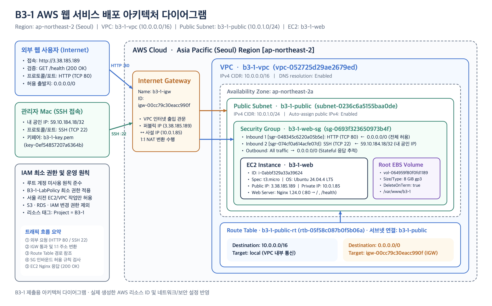
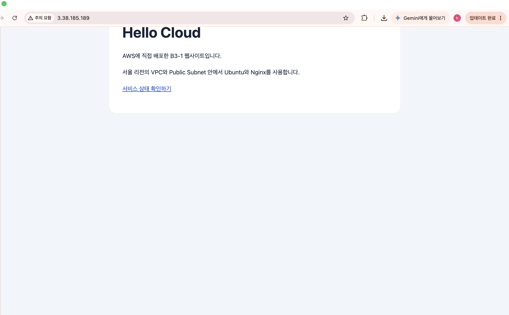

# B3-1 AWS 웹 서비스 배포

AWS 서울 리전(`ap-northeast-2`)에 격리된 가상 네트워크(VPC)와 Public Subnet을 설계·구축하고, 최소 권한 원칙(IAM 및 Security Group)을 적용하여 Ubuntu EC2 인스턴스에 Nginx 웹 서비스를 배포·검증한 프로젝트입니다.

---

## 1. 아키텍처 다이어그램



---

## 2. 환경 및 리소스 구성

| 구분 | 이름 (Name) | 실제 ID / 설정 값 | 비고 |
| :--- | :--- | :--- | :--- |
| **리전 (Region)** | Asia Pacific (Seoul) | `ap-northeast-2` | 가용 영역: `ap-northeast-2a` |
| **VPC** | `b3-1-vpc` | `vpc-052725d29ae2679ed` | IPv4 CIDR: `10.0.0.0/16` |
| **Public Subnet** | `b3-1-public` | `subnet-0236c6a5155baa0de` | IPv4 CIDR: `10.0.1.0/24` (퍼블릭 IP 자동 할당 활성화) |
| **Internet Gateway** | `b3-1-igw` | `igw-00cc79c30eacc990f` | `b3-1-vpc`에 연결(Attached) |
| **Route Table** | `b3-1-public-rt` | `rtb-05f58c087b0f5b06a` | `10.0.0.0/16 → local`, `0.0.0.0/0 → igw-00cc79c30eacc990f` |
| **Security Group** | `b3-1-web-sg` | `sg-0693f323650973b4f` | HTTP(80): `0.0.0.0/0`, SSH(22): `59.10.184.18/32` |
| **EC2 인스턴스** | `b3-1-web` | `i-0abbf329a33a39624` | `t3.micro` / Ubuntu Server 24.04.4 LTS (x86_64) |
| **EC2 주소** | - | 퍼블릭 IP: `3.38.185.189` | 프라이빗 IP: `10.0.1.85` |
| **EBS 루트 볼륨** | 루트 볼륨 (`/dev/sda1`) | `vol-064959f80f0fd1189` | `8 GiB`, `gp3` (`DeleteOnTermination: true`) |
| **SSH 키페어** | `b3-1-key` | `key-0ef54857207a6364b` | RSA (`.pem`, `chmod 400` 권한 제한 적용) |
| **웹 서버** | Nginx | `nginx/1.24.0 (Ubuntu)` | 정적 페이지(`/`) 및 헬스체크(`/health`) 제공 |

---

## 3. 외부 접속 검증

- **선택 방식**: **방식 B — `GET http://<퍼블릭IP>/health` 호출** (추가로 방식 A 브라우저 웹페이지 접속도 함께 검증 완료)
- **실제 접속 URL**:
  - 헬스체크(B): `http://3.38.185.189/health`
  - 웹페이지(A): `http://3.38.185.189/`
- **실행 위치**: EC2 외부의 개인 Mac 터미널 (`hankkim@hankkimui-MacBookAir`) 및 웹 브라우저
- **검증 일시 및 시간대**: `2026-10-19 14:29:06 KST` (`Mon, 19 Oct 2026 05:29:07 GMT`)
- **실제 결과**: `HTTP/1.1 200 OK` 상태 코드 및 본문 `OK` 정상 반환 확인

### 3-1. 외부 헬스체크 호출 결과 (`GET http://3.38.185.189/health`)
```text
$ date '+%Y-%m-%d %H:%M:%S %Z'
$ curl -i --connect-timeout 5 --max-time 10 http://3.38.185.189/health
2026-10-19 14:29:06 KST
HTTP/1.1 200 OK
Server: nginx/1.24.0 (Ubuntu)
Date: Mon, 19 Oct 2026 05:29:07 GMT
Content-Type: text/plain
Content-Length: 3
Connection: keep-alive

OK
```


### 3-2. 외부 브라우저 웹페이지 접속 결과 (`http://3.38.185.189`)


### 3-3. EC2 내부 로컬 응답 검증 (`curl -i http://localhost/health`)


---

## 4. 재현 방법

### 4-1. 네트워크 및 보안 구성
1. **VPC 및 Subnet 생성**:
   - 서울 리전(`ap-northeast-2`)에 `b3-1-vpc`(`10.0.0.0/16`) 생성
   - 가용 영역 `ap-northeast-2a`에 `b3-1-public`(`10.0.1.0/24`) 생성 및 퍼블릭 IPv4 자동 할당 활성화
2. **Internet Gateway 및 Route Table 연결**:
   - `b3-1-igw`(`igw-00cc79c30eacc990f`)를 생성하여 `b3-1-vpc`에 연결(Attach)
   - `b3-1-public-rt`(`rtb-05f58c087b0f5b06a`)에 `0.0.0.0/0 → igw-00cc79c30eacc990f` 경로를 추가하고 `b3-1-public` 서브넷을 명시적으로 연결(Explicit Subnet Association)
   - 증빙 캡처: [라우팅 경로](docs/screenshots/network-routes.png) · [서브넷 연결](docs/screenshots/network-association.png) · [VPC 리소스 맵](docs/screenshots/resource-map.png)
3. **Security Group (`b3-1-web-sg`, `sg-0693f323650973b4f`) 최소 권한 설정**:
   - **Inbound 규칙**:
     - `HTTP (TCP 80)`: `0.0.0.0/0` 허용 (`sgr-048345c6220a05b5e`) — 외부 웹 서비스 접근용
     - `SSH (TCP 22)`: `59.10.184.18/32` 허용 (`sgr-074cf0a614acfe07d`) — 관리자 개인 공인 IP에서만 접속 허용
     - 전체 포트(`0-65535`) 무제한 허용 규칙은 생성하지 않음
   - **Outbound 규칙**: 기본 전체 허용 유지 (Stateful 연결 추적 활용)
   - 증빙 캡처: [보안 그룹 규칙](docs/screenshots/security-group.png)
4. **IAM 최소 권한 적용**:
   - 루트 계정을 사용하지 않고 실습용 IAM 사용자(`arn:aws:iam::061166140571:user/b3-1-learn`)에 최소 권한 정책([`infra/iam-policy.json`](infra/iam-policy.json))을 부여하여 실습 수행
   - 서울 리전(`ap-northeast-2`)의 EC2/VPC 필수 작업 및 `t3.micro`/`t2.micro` 인스턴스 실행만 허용하며, S3·RDS·IAM 변경 및 `AdministratorAccess` 권한은 부여하지 않음
   - 정적 파일만 서빙하는 Nginx 특성상 AWS API를 호출하지 않으므로 EC2 인스턴스 프로파일(IAM Role)은 부착하지 않음

### 4-2. SSH 접속 및 Nginx 설치·배포 명령
```bash
# 1. 개인 Mac에서 키페어 권한 설정 및 SSH 접속
chmod 400 "$HOME/.ssh/b3-1-key.pem"
ssh -i "$HOME/.ssh/b3-1-key.pem" ubuntu@3.38.185.189

# 2. EC2 내부에서 외부 아웃바운드 통신 확인 및 Nginx 설치
curl -I --max-time 10 https://example.com
sudo apt update
sudo apt install -y nginx
sudo systemctl enable --now nginx

# 3. 웹페이지(/var/www/b3-1/index.html) 및 Nginx 설정(/etc/nginx/sites-available/b3-1) 배포
sudo mkdir -p /var/www/b3-1
# (web/index.html 및 infra/nginx.conf 내용 반영)
sudo ln -sfn /etc/nginx/sites-available/b3-1 /etc/nginx/sites-enabled/b3-1
sudo rm -f /etc/nginx/sites-enabled/default
sudo nginx -t
sudo systemctl reload nginx

# 4. 내부 응답 확인
curl -i --max-time 10 http://localhost/health
```
- 보관된 설정 파일: [`web/index.html`](web/index.html) · [`infra/nginx.conf`](infra/nginx.conf)
- 증빙 캡처: [EC2 인스턴스 상태](docs/screenshots/instance.png) · [호스트 키 지문 확인](docs/screenshots/system-log-fingerprint.png) · [SSH 접속 화면](docs/screenshots/ssh-connection.png)

---

## 5. 제출 문서

1. **아키텍처 다이어그램**: [`docs/architecture.png`](docs/architecture.png)
2. **외부 접속 검증 증빙**: 본 `README.md` 및 [`docs/screenshots/external-health.png`](docs/screenshots/external-health.png)
3. **트러블슈팅 보고서**: [`docs/troubleshooting.md`](docs/troubleshooting.md)
4. **리소스 정리 체크리스트**: [`docs/cleanup-checklist.md`](docs/cleanup-checklist.md)
5. **리소스 인벤토리 기록**: [`docs/resource-inventory.md`](docs/resource-inventory.md)

---

## 6. 서비스 종료 및 리소스 정리

- **현재 상태**: 모든 실습 리소스 종료 및 삭제 완료 (`Terminated` / `Deleted`)
- **리소스 정리 완료 일시**: `2026-10-19 15:13 KST`
- **정리 증빙 캡처**: [EC2 종료 확인](docs/screenshots/terminate-instance.png) · [EBS 삭제 확인](docs/screenshots/ebs-deleted.png) · [VPC 삭제 확인](docs/screenshots/vpc-deleted.png) · [Billing 비용 요약(`US$0.00`)](docs/screenshots/billing.png) (상세 내역은 [`docs/cleanup-checklist.md`](docs/cleanup-checklist.md) 참조)
- **안내**: 리소스 정리 완료 이후에는 해당 URL(`http://3.38.185.189/health`)로 서비스에 접속할 수 없습니다.

