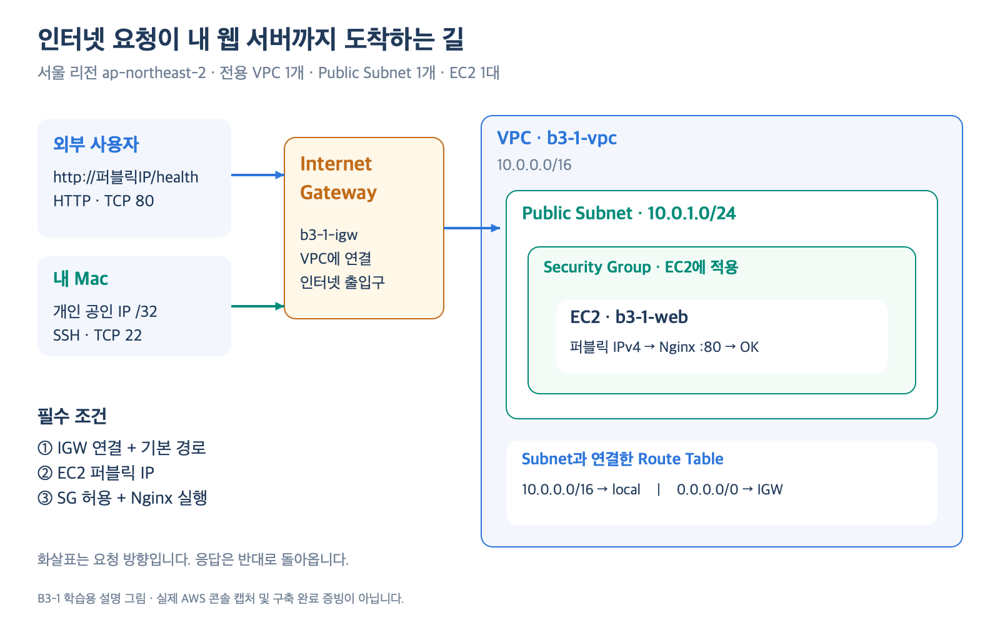
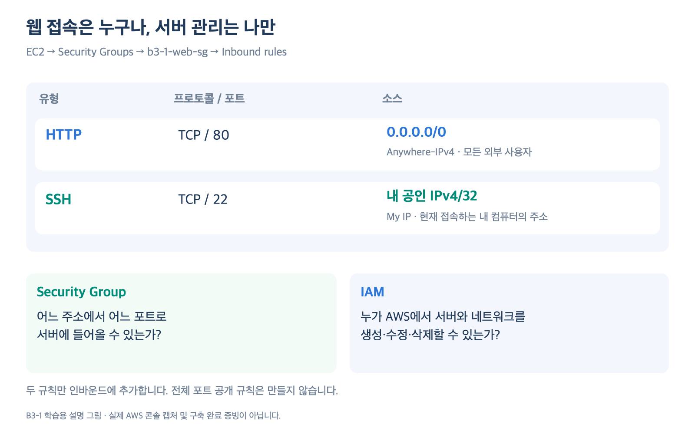
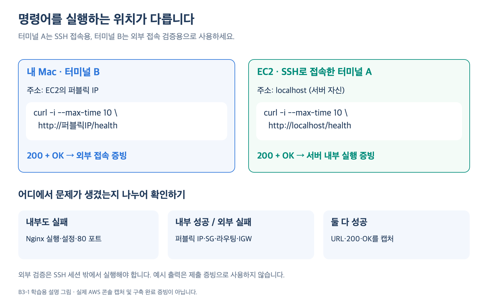

# B3-1을 직접 수행하기 위한 AWS·네트워크·서버 지식 노트

작성·공식 자료 확인: 2026-09-10

이 문서는 **실습에서 하는 설정의 의미와 문제를 해결하는 사고방식**을 설명한다. 실제 클릭 순서와 설치 명령은 [AWS 실습 가이드](aws-hands-on-guide.md)를 따라가고, 이해가 필요한 부분은 이 문서를 함께 읽는다. 과제의 기준은 [subject.md](../subject.md)다.

예시 주소, 출력, 장애 사례는 학습용이며 실제 구축·검증 결과가 아니다. `203.0.113.10`과 `198.51.100.25`는 문서 예시에 쓰는 예약 주소이므로 실제 접속 대상으로 사용하지 않는다. 명령의 `YOUR_EC2_PUBLIC_IP`는 AWS 콘솔에서 확인한 본인 서버의 실제 퍼블릭 IPv4로 바꾼다. [문서용 주소 범위: RFC 5737](https://www.rfc-editor.org/rfc/rfc5737.html)

## 읽는 순서

처음부터 전부 외울 필요는 없다. 실습을 시작하기 전에 1~7장을 읽고, 서버에 접속할 때 8~12장, 검증과 정리를 할 때 13~16장을 읽는다. 17~20장은 복습과 발표 준비에 사용한다.

| 실습 가이드의 단계 | 이 문서에서 읽을 부분 | 스스로 설명할 내용 |
| --- | --- | --- |
| 0. 계정·비용·권한 준비 | 1, 7, 15장 | 클라우드에서 내가 관리하는 범위와 IAM 권한 |
| 1~4. VPC·Subnet·IGW·경로 | 2~5장 | 주소 범위와 인터넷 왕복 경로 |
| 5. Security Group | 6~7장 | 통신 허용과 AWS 작업 권한의 차이 |
| 6. EC2 생성 | 8장 | AMI·인스턴스 유형·EBS·퍼블릭 IP |
| 7. SSH | 9~10장 | 서버 접속과 Linux 명령 실행 위치 |
| 8. Nginx | 10~11장 | 프로세스·서비스·설정 파일·포트 |
| 9. 외부 접속 검증 | 12~13장 | HTTP 응답과 내부·외부 검증 차이 |
| 10. 트러블슈팅 | 14장 | 가설과 관측 사실을 구분하는 방법 |
| 11~12. 제출·정리 | 15~16장 | 증빙 범위와 삭제 순서 |

### 목차

1. [클라우드와 웹 서비스의 전체 구조](#1-클라우드와-웹-서비스의-전체-구조)
2. [인터넷 통신을 이해하는 최소 단위](#2-인터넷-통신을-이해하는-최소-단위)
3. [IP 주소와 CIDR 읽기](#3-ip-주소와-cidr-읽기)
4. [Region·AZ·VPC·Subnet의 관계](#4-regionazvpcsubnet의-관계)
5. [라우팅·IGW·퍼블릭 IP·DNS](#5-라우팅igw퍼블릭-ipdns)
6. [Security Group과 Network ACL](#6-security-group과-network-acl)
7. [IAM과 최소권한](#7-iam과-최소권한)
8. [EC2와 저장 공간](#8-ec2와-저장-공간)
9. [SSH와 키페어](#9-ssh와-키페어)
10. [Linux·셸·파일 권한·서비스](#10-linux셸파일-권한서비스)
11. [Nginx 설정을 한 줄씩 이해하기](#11-nginx-설정을-한-줄씩-이해하기)
12. [HTTP와 curl 결과 읽기](#12-http와-curl-결과-읽기)
13. [요청 하나의 전체 여정](#13-요청-하나의-전체-여정)
14. [오류를 근거로 분석하는 방법](#14-오류를-근거로-분석하는-방법)
15. [비용과 리소스 수명 관리](#15-비용과-리소스-수명-관리)
16. [제출 자료와 재현 가능성](#16-제출-자료와-재현-가능성)
17. [자주 생기는 오해](#17-자주-생기는-오해)
18. [HTTPS·Docker와 이후 확장](#18-httpsdocker와-이후-확장)
19. [용어·명령어 빠른 사전](#19-용어명령어-빠른-사전)
20. [이해도 점검 문제와 해설](#20-이해도-점검-문제와-해설)

## 1. 클라우드와 웹 서비스의 전체 구조

### 1-1. 이번에 만드는 것

내 Mac이 아닌 AWS의 컴퓨터에서 웹 서버 프로그램을 실행하고, 다른 컴퓨터가 인터넷을 통해 그 프로그램에 요청을 보낼 수 있도록 만든다.

구성에는 세 층이 있다.

| 층 | 이번 실습의 요소 | 해결하는 문제 |
| --- | --- | --- |
| 실행 환경 | EC2, Ubuntu, CPU·메모리, EBS | 프로그램을 어디에서 실행하고 파일을 어디에 저장할 것인가 |
| 통신 환경 | VPC, Subnet, IP, Route Table, IGW, SG | 요청이 어떤 경로로 도착하고 어떤 통신을 허용할 것인가 |
| 서비스 | Nginx, HTML, `/health` | 도착한 요청에 무엇을 반환할 것인가 |

IAM은 이 환경을 **누가 만들고 변경할 수 있는지** 제어한다. IAM 사용자가 웹 서버에 상주하며 HTTP 요청을 대신 처리하는 구조는 아니다.

### 1-2. 서버라는 말의 두 의미

“서버를 만들었다”는 문장은 두 의미로 쓰인다.

- **컴퓨터로서의 서버:** EC2 인스턴스를 생성해 Ubuntu가 실행되고 있다.
- **프로그램으로서의 서버:** Nginx 프로세스가 실행되며 TCP 80에서 HTTP 요청을 기다린다.

EC2가 Running이어도 Nginx가 설치되지 않았거나 종료되어 있으면 웹페이지는 열리지 않는다. 반대로 Nginx가 잘 실행돼도 인터넷 경로가 없으면 외부에서 접속할 수 없다. 이 구분은 장애 진단의 출발점이다.

### 1-3. 배포란 무엇인가

배포는 작성한 파일과 설정을 실제 서비스 환경에 반영해 사용자가 접근할 수 있게 만드는 작업이다. 이번에는 다음을 묶어 배포라고 부른다.

1. EC2와 네트워크를 준비한다.
2. Nginx를 설치한다.
3. HTML과 설정 파일을 서버에 배치한다.
4. 설정을 검사하고 적용한다.
5. 사용자의 위치에서 요청을 보내 결과를 확인한다.

Git에 파일을 올린 것, 내 Mac에서 HTML을 연 것, EC2를 생성한 것 각각만으로 이 과제의 배포가 끝나지는 않는다.

### 1-4. AWS 콘솔과 내 웹사이트는 서로 다른 통신

```text
관리 작업: 내 브라우저 → AWS 콘솔/API → IAM 권한 확인 → EC2·VPC 설정 변경
서비스 사용: 사용자 브라우저 → EC2의 퍼블릭 IP → Nginx → 웹페이지 응답
서버 관리: 내 터미널 → EC2의 TCP 22 → SSH 인증 → Ubuntu 셸
```

콘솔에서 인스턴스 목록을 보는 것은 AWS 관리 API 작업이다. `http://퍼블릭IP/health`는 내 Nginx에 보내는 HTTP 요청이다. IAM 권한 오류와 HTTP 접속 오류는 확인할 위치가 다르다.

### 1-5. 클라우드에서도 내가 해야 하는 일

AWS가 물리 장비와 기반 시설을 관리해도, 이번 EC2 실습에서는 OS 안의 패키지, Nginx 설정, 공개할 포트, 사용자 권한, 키 보관, 파일 내용, 리소스 정리를 직접 관리한다. “AWS에 올렸으므로 설정과 운영이 자동으로 안전해졌다”는 의미가 아니다.

과제에서는 단일 인스턴스로 학습한다. 이 구조만으로 여러 AZ 장애 대응, 무중단 배포, 자동 확장, 백업 복구 체계가 완성되는 것은 아니다.

## 2. 인터넷 통신을 이해하는 최소 단위

### 2-1. 클라이언트와 서버

**클라이언트**는 요청하는 프로그램이고, **서버**는 요청을 받아 응답하는 프로그램이다. 브라우저와 `curl`은 HTTP 클라이언트가 될 수 있고 Nginx는 HTTP 서버가 될 수 있다.

역할은 컴퓨터에 영구적으로 붙는 이름이 아니다. EC2에서 `curl https://example.com`을 실행할 때 EC2는 외부 웹사이트에 대한 클라이언트다. Mac에서 EC2에 요청할 때는 EC2가 서버 역할을 한다.

### 2-2. IP·포트·프로토콜은 다른 정보

| 정보 | 예시 | 뜻 |
| --- | --- | --- |
| IP 주소 | `203.0.113.10` | 어디로 통신할 것인가 |
| 포트 | `80` | 그 컴퓨터의 어떤 통신 종단으로 접근할 것인가 |
| 전송 프로토콜 | TCP | 데이터를 어떤 전송 규칙으로 주고받을 것인가 |
| 응용 프로토콜 | HTTP | 요청과 응답의 내용을 어떤 형식으로 해석할 것인가 |

주소만 맞아도 안 되고 포트만 열어도 안 된다. 목적지와 프로토콜이 맞고 해당 포트에서 프로그램이 요청을 받아야 한다.

TCP와 UDP는 서로 다른 전송 프로토콜이다. SG에서 UDP 80을 허용하는 것은 이번 TCP 기반 HTTP 서비스의 TCP 80을 허용한 것과 다르다. `ping`은 일반적으로 ICMP를 사용하므로 HTTP가 되는지 직접 증명하지 못한다.

### 2-3. 서버 포트와 클라이언트 포트

이번 웹 서버는 TCP 80을 기다린다. 클라이언트는 연결할 때 별도의 임시 출발지 포트를 사용한다.

```text
요청: Mac의 공인 IP:임시 포트  ──→  서버 퍼블릭 IP:80
응답: 서버 퍼블릭 IP:80        ──→  Mac의 공인 IP:임시 포트
```

예를 들어 클라이언트 포트가 53124라면 응답의 목적지 포트는 53124다. 실제 임시 포트 범위와 NAT 변환은 OS·네트워크에 따라 다르다. SG의 상태 추적과 ACL의 응답 규칙을 이해할 때 이 개념이 필요하다.

### 2-4. TCP 연결과 HTTP 응답의 순서

이번 실습의 HTTP/1.1 통신을 단순화하면 다음과 같다.

1. 클라이언트가 서버와 TCP 연결을 맺는다.
2. 연결 위로 `GET /health`라는 HTTP 요청을 보낸다.
3. Nginx가 HTTP 상태 코드와 본문을 반환한다.

TCP 연결의 시작은 흔히 `SYN → SYN-ACK → ACK`의 세 단계로 설명한다. 깊게 외울 필요는 없지만 **HTTP 요청을 해석하기 전에 연결이 먼저 성립해야 한다**는 점은 알아야 한다.

따라서 “연결 타임아웃”과 “HTTP 404”는 같은 오류가 아니다. 404를 받았다면 어떤 HTTP 응답 주체와 통신한 것이고, 연결 단계 타임아웃은 HTTP 상태 코드 자체가 없을 수 있다. 프록시를 사용하는 환경에서는 응답 주체가 내 EC2인지도 확인한다.

### 2-5. URL 읽기

```text
http://203.0.113.10:80/health?check=1
│      │             │  │      └─ 쿼리 문자열
│      │             │  └──────── 경로
│      │             └─────────── 포트
│      └───────────────────────── 호스트
└──────────────────────────────── 스킴
```

HTTP는 기본 포트 80이므로 `:80`을 생략할 수 있다. HTTPS의 기본 포트는 443이다. 브라우저가 `http://`를 `https://`로 바꾸면 다른 포트와 TLS 설정을 기대하게 된다.

`/health`는 EC2나 AWS가 자동으로 제공하는 기능이 아니다. 이번에는 Nginx 설정으로 직접 만든 경로다. 디스크에 `health`라는 파일을 만들지 않아도 설정의 `return`으로 응답할 수 있다.

## 3. IP 주소와 CIDR 읽기

### 3-1. IPv4 주소의 구조

IPv4 주소는 32비트이며 보통 8비트씩 네 부분으로 나누어 표시한다. 각 부분은 0~255 범위다.

```text
10.0.1.20
10       .0        .1        .20
00001010 .00000000 .00000001 .00010100
```

비트 계산을 모두 암기하기보다, 주소의 일부를 네트워크 범위로 묶는 것이 CIDR이라는 점을 이해하면 된다.

### 3-2. `/16`, `/24`, `/32`의 의미

CIDR의 `/숫자`는 앞에서부터 몇 비트를 네트워크 접두사로 고정하는지 뜻한다. 숫자가 커질수록 포함하는 주소 범위는 작아진다.

```text
전체 주소 개수 = 2^(32 - 접두사 길이)
```

| 표기 | 전체 범위 | 전체 주소 수 | 실습에서의 의미 |
| --- | --- | ---: | --- |
| `10.0.0.0/16` | `10.0.0.0` ~ `10.0.255.255` | 65,536 | VPC 범위 |
| `10.0.1.0/24` | `10.0.1.0` ~ `10.0.1.255` | 256 | Public Subnet 범위 |
| `198.51.100.25/32` | 해당 주소 하나 | 1 | SSH 허용 소스의 예시 |
| `0.0.0.0/0` | 전체 IPv4 범위 | 4,294,967,296 | 모든 IPv4 주소에 매칭 |

`/24`는 앞의 24비트, 즉 이 예시에서는 `10.0.1` 부분을 고정한다. `/16`은 `10.0`을 고정한다. `/20`처럼 8의 배수가 아닌 접두사도 있으므로 CIDR이 항상 점 단위로만 나뉘는 것은 아니다.

### 3-3. AWS Subnet에서 256대를 모두 배치할 수 없는 이유

이번의 일반적인 AWS IPv4 Subnet은 맨 앞 네 주소와 마지막 주소를 예약한다. `10.0.1.0/24`에서는 다음과 같다.

| 주소 | 용도 |
| --- | --- |
| `10.0.1.0` | 네트워크 주소 |
| `10.0.1.1` | VPC 라우터용 예약 |
| `10.0.1.2` | AWS 예약 |
| `10.0.1.3` | 향후 사용을 위한 예약 |
| `10.0.1.255` | 마지막 주소 예약. VPC는 일반 브로드캐스트를 지원하지 않음 |

따라서 이 `/24`에서 리소스에 할당 가능한 주소는 최대 251개다. 실제 여유 수는 EC2 외의 네트워크 인터페이스 사용량도 영향을 준다. `10.0.1.2`가 예약됐다고 이 설계의 DNS 서버가 그 주소라는 뜻은 아니다. 기본 VPC CIDR이 `10.0.0.0/16`이면 VPC 기반 DNS 주소는 `10.0.0.2`다. [AWS Subnet 주소 예약](https://docs.aws.amazon.com/vpc/latest/userguide/subnet-sizing.html), [Amazon DNS 주소](https://docs.aws.amazon.com/en_en/vpc/latest/userguide/AmazonDNS-concepts.html)

### 3-4. VPC와 Subnet의 범위 관계

이번 설계에서는 `10.0.1.0/24`가 `10.0.0.0/16` 안에 포함된다.

- `10.0.2.0/24`를 추가하면 기존 Subnet과 겹치지 않는다.
- `10.0.1.128/25`는 기존 `10.0.1.0/24` 안에 포함되므로 같은 VPC에 겹치는 별도 Subnet으로 만들 수 없다.
- `10.1.1.0/24`는 이번 VPC CIDR 바깥이므로 현재 설계의 Subnet 범위로 사용할 수 없다.

연결할 네트워크끼리 주소가 겹치면 이후 VPN·피어링 등의 통신 설계가 어려워진다. 이번에는 과제용 VPC 하나지만, 주소 범위도 설계의 일부라는 점을 기억한다.

### 3-5. 사설 IP와 공인 IP

일반적인 사설 IPv4 주소 범위는 다음과 같다.

| 범위 | 흔히 보는 주소 |
| --- | --- |
| `10.0.0.0/8` | VPC 내부 `10.0.1.20` |
| `172.16.0.0/12` | `172.16.x.x` ~ `172.31.x.x` |
| `192.168.0.0/16` | 집이나 사무실의 `192.168.x.x` |

사설 주소는 서로 독립된 네트워크에서 반복해 사용할 수 있으며 공용 인터넷에서 직접 목적지로 라우팅하는 주소가 아니다. 내 Mac에서 EC2의 `10.0.1.20`으로 바로 접속하려면 VPN 같은 별도 사설 연결이 필요하다. 이번에는 EC2의 퍼블릭 IPv4를 사용한다. [사설 주소 정의: RFC 1918](https://www.rfc-editor.org/rfc/rfc1918.html)

### 3-6. 내 Mac의 IP가 두 가지로 보이는 이유

Mac은 집 공유기 안에서 `192.168.x.x` 주소를 사용할 수 있다. 인터넷으로 나갈 때 공유기나 ISP의 NAT를 거쳐 외부에서는 다른 공인 주소로 보일 수 있다.

SG의 SSH 소스는 **AWS가 접속 출발지로 관측하는 주소**여야 한다. 그래서 Mac의 네트워크 설정에 있는 사설 주소보다 `My IP` 또는 공인 IP 확인 결과를 사용한다. 회사 프록시·VPN·모바일 핫스폿을 바꾸면 이 주소도 바뀔 수 있다.

### 3-7. `0.0.0.0`과 `0.0.0.0/0`의 문맥 차이

| 나타나는 곳 | 의미 |
| --- | --- |
| SG의 소스 `0.0.0.0/0` | 모든 IPv4 출발지에 매칭 |
| Route Table의 목적지 `0.0.0.0/0` | 더 구체적인 경로가 없는 IPv4 목적지의 기본 경로 |
| 서버 리스닝 주소 `0.0.0.0:80` | 로컬의 모든 IPv4 인터페이스에서 TCP 80을 수신 |

리스닝 주소가 `0.0.0.0`이어도 SG와 라우팅이 열려 있어야 외부에서 접근할 수 있다. `0.0.0.0`을 브라우저에 넣을 실제 서버 주소로 생각하면 안 된다.

## 4. Region·AZ·VPC·Subnet의 관계

### 4-1. 포함 관계

```text
AWS 계정
└─ 서울 리전 ap-northeast-2
   └─ VPC 10.0.0.0/16
      ├─ 서울 AZ 하나
      │  └─ Public Subnet 10.0.1.0/24
      │     └─ EC2
      └─ 다른 AZ의 Subnet을 필요할 때 추가할 수 있음
```

VPC는 한 리전의 네트워크이고 그 리전 안의 여러 AZ에 걸쳐 Subnet을 둘 수 있다. **Subnet 하나는 AZ 하나에 속한다.** 이번에는 Subnet과 EC2를 각각 한 개씩만 사용한다. [AWS Region·AZ](https://docs.aws.amazon.com/AWSEC2/latest/UserGuide/using-regions-availability-zones.html), [Subnet의 AZ 범위](https://docs.aws.amazon.com/vpc/latest/userguide/configure-subnets.html)

AZ를 데이터센터 건물 하나와 완전히 같은 뜻으로 외우지는 않는다. AWS가 장애 격리를 위해 구분한 영역으로 이해하면 된다.

### 4-2. 리전 선택이 실제로 중요한 이유

서울에 만든 인스턴스를 다른 리전의 EC2 목록에서 찾으면 안 보일 수 있다. AMI·키페어·SG 등의 선택도 현재 작업 중인 리전과 연결된 환경에 따라 달라진다.

따라서 생성·조회·삭제 시 모두 `ap-northeast-2`인지 확인한다. 이름만 보고 리소스가 사라졌다고 판단하지 말고 계정, 리전, 필터, 리소스 ID를 함께 확인한다.

### 4-3. VPC와 Subnet을 따로 만드는 이유

VPC는 전체 주소·네트워크 경계를 정하고, Subnet은 EC2가 배치될 주소 범위와 AZ를 구체화한다. 나중에는 웹 서버용, 애플리케이션용, DB용 Subnet으로 역할을 분리할 수 있다.

이번 과제의 전용 VPC는 설정과 정리 대상을 이해하기 쉽게 만든다. AWS가 제공하는 기본 VPC가 있더라도 요구사항의 VPC·Subnet·IGW·Route Table 구성을 직접 수행해야 학습 목표를 확인할 수 있다.

### 4-4. Public Subnet과 Private Subnet

Public 여부는 이름보다 라우팅으로 결정한다.

| 구분 | 인터넷 게이트웨이로의 직접 경로 | 전형적인 사용 |
| --- | --- | --- |
| Public Subnet | 있음 | 인터넷 진입점, 이번 실습의 웹 서버 |
| Private Subnet | 없음 | 직접 공개하지 않는 애플리케이션·DB |

Private Subnet도 구성에 따라 NAT Gateway 등을 통해 인터넷으로 나갈 수 있다. “Private = 어떤 외부 통신도 불가능”이라는 뜻은 아니다. [AWS Subnet 유형](https://docs.aws.amazon.com/vpc/latest/userguide/configure-subnets.html)

Public Subnet에 EC2를 배치했다고 EC2가 자동 공개되지는 않는다. 이번 IPv4 구성에서는 퍼블릭 IP·SG·서버 리스닝이 추가로 맞아야 한다. 반대로 SG에서 80을 허용했다고 Private Subnet의 서버에 인터넷 경로가 자동으로 생기는 것도 아니다.

## 5. 라우팅·IGW·퍼블릭 IP·DNS



### 5-1. Route Table은 경로를 고른다

Route Table은 패킷의 목적지 주소와 맞는 경로를 찾아 전달 대상을 결정한다. 웹 서버 프로세스나 방화벽 규칙을 생성하는 기능은 아니다.

| Destination | Target | 뜻 |
| --- | --- | --- |
| `10.0.0.0/16` | `local` | 이 VPC 내부 주소로 전달 |
| `0.0.0.0/0` | `igw-...` | 나머지 IPv4 목적지는 인터넷 게이트웨이로 전달 |

`local` 경로가 있다고 VPC 내부의 모든 포트가 허용되는 것은 아니다. 접근 허용은 SG·ACL 등에서 따로 결정한다.

### 5-2. 더 구체적인 경로가 우선한다

목적지가 `10.0.1.20`이면 `/16`과 `/0` 모두에 포함된다. 이 경우 더 긴 접두사 `/16` 경로가 우선한다. 이것을 longest prefix match라고 부른다.

그래서 기본 경로를 추가해도 모든 내부 통신이 IGW로 빠져나가는 것은 아니다. 이 규칙을 알아야 경로가 여러 개일 때 어느 경로를 사용하는지 판단할 수 있다. [AWS 경로 우선순위](https://docs.aws.amazon.com/vpc/latest/userguide/route-tables-priority.html)

### 5-3. 경로표를 만들고도 인터넷이 안 되는 이유

Subnet이 실제로 사용해야 하는 Route Table을 연결하지 않았을 수 있다. Subnet은 명시적 연결이 없으면 VPC의 main Route Table을 사용한다.

확인은 두 부분이다.

1. `b3-1-public-rt` 안에 `0.0.0.0/0 → b3-1-igw`가 있는가.
2. `b3-1-public`이 실제로 그 Route Table에 연결되어 있는가.

테이블 이름이 그럴듯하다는 것보다 연결된 Subnet ID가 결정적인 근거다. [AWS Subnet 라우팅](https://docs.aws.amazon.com/vpc/latest/userguide/configure-subnets.html)

### 5-4. Internet Gateway의 역할

IGW를 VPC에 연결하면 인터넷과 통신할 수 있는 기반이 생긴다. 하지만 IGW 생성·연결만으로 EC2에 퍼블릭 IP가 생기거나 모든 포트가 열리지는 않는다.

이번 IPv4 모델에서는 IGW가 EC2의 퍼블릭 IPv4와 사설 IPv4 사이의 주소 변환도 수행한다. 따라서 Ubuntu 안에서 `ip addr`를 실행했을 때 퍼블릭 IP가 인터페이스 주소로 직접 보이지 않아도 이상한 상황은 아니다. [AWS IGW와 IPv4 주소 변환](https://docs.aws.amazon.com/vpc/latest/userguide/VPC_Internet_Gateway.html)

### 5-5. 인터넷 왕복에 필요한 조건

이번 구성에서 외부 요청이 정상 처리되려면 다음 조건을 함께 만족해야 한다.

- IGW가 올바른 VPC에 연결되어 있다.
- EC2가 올바른 Subnet에 있다.
- Subnet의 실제 Route Table에 IGW 기본 경로가 있다.
- EC2에 인터넷에서 사용할 퍼블릭 IPv4가 있다.
- EC2의 실제 SG가 필요한 TCP 포트를 허용한다.
- ACL과 OS 방화벽이 필요한 요청·응답을 막지 않는다.
- 프로그램이 해당 인터페이스와 포트에서 실행 중이다.

이 목록은 요청과 응답 모두를 고려한다. Route Table을 외부 사용자가 반드시 거쳐 가는 별도 물리 장비처럼 그리기보다, Subnet에 적용되는 경로 결정 규칙으로 이해한다.

### 5-6. 자동 할당 퍼블릭 IP와 Elastic IP

| 항목 | 자동 할당 퍼블릭 IPv4 | Elastic IP |
| --- | --- | --- |
| 목적 | 일반적인 외부 통신 주소 제공 | 계정에서 보유하는 고정 퍼블릭 IPv4 |
| 이번 사용 | 사용 | 별도 할당하지 않음 |
| 수명 | 인스턴스 상태 변화에 따라 반환·변경 가능 | 명시적으로 Release할 때까지 할당 유지 |
| 정리 확인 | EC2 종료와 함께 확인 | 연결 해제만이 아니라 Release 확인 |

일반적인 자동 할당 IPv4는 Stop 후 Start할 때 달라질 수 있고 Reboot에서는 유지된다. 연결이 안 되면 오래 적어 둔 주소보다 콘솔의 현재 주소를 확인한다. [EC2 IP 주소 수명](https://docs.aws.amazon.com/AWSEC2/latest/UserGuide/using-instance-addressing.html)

### 5-7. DNS가 필요한 경우

DNS는 `example.com` 같은 이름을 IP 주소로 찾는 데 쓰인다. `curl https://example.com`과 패키지 저장소 접속에는 이름 해석이 필요하다. 반면 이번 `http://실제퍼블릭IP/health`는 호스트가 숫자 IP이므로 그 목적지 호스트의 DNS 조회를 생략한다.

VPC의 DNS resolution과 DNS hostnames는 역할이 다르다.

| 설정 | 이해할 내용 |
| --- | --- |
| DNS resolution | Amazon 제공 DNS를 이용한 이름 해석과 관련 |
| DNS hostnames | 인스턴스의 DNS 호스트명 부여 등과 관련 |

퍼블릭 IP로 접속한다고 `apt update`에 필요한 이름 해석까지 필요 없어지는 것은 아니다. 반대로 DNS가 성공했다고 HTTP 서버가 정상이라는 뜻도 아니다. [Amazon DNS 설명](https://docs.aws.amazon.com/en_en/vpc/latest/userguide/AmazonDNS-concepts.html)

## 6. Security Group과 Network ACL



### 6-1. Security Group이 검사하는 것

SG는 연결된 네트워크 인터페이스·리소스의 인바운드와 아웃바운드 통신을 허용하는 규칙이다. 이번에는 EC2 생성 시 `b3-1-web-sg`를 연결한다.

```text
HTTP 규칙: TCP / 목적지 포트 80 / 출발지 0.0.0.0/0
SSH 규칙:  TCP / 목적지 포트 22 / 출발지 내 공인 IPv4/32
```

HTTP 규칙은 웹페이지와 `/health`에 접근하게 한다. SSH 규칙은 OS 명령을 실행할 수 있는 관리 접속을 제한한다. SG가 사용자명이나 개인 키를 검사하는 것은 아니며, SSH 인증은 접속이 서버에 도착한 뒤 별도로 수행된다.

### 6-2. Inbound와 Outbound의 기준

기준은 EC2다.

| 상황 | EC2 기준 |
| --- | --- |
| Mac이 EC2에 HTTP 요청 | 새로운 인바운드 통신 |
| Mac이 EC2에 SSH 접속 | 새로운 인바운드 통신 |
| EC2가 패키지 저장소에 접속 | 새로운 아웃바운드 통신 |
| Nginx가 허용된 HTTP 요청에 응답 | 해당 연결의 응답 트래픽 |

이번에는 인바운드를 제한하고 기본 아웃바운드 허용을 유지한다. 과제 요구 수준의 선택이며, 모든 실제 서비스에서 아웃바운드를 무제한으로 두는 것이 최선이라는 의미는 아니다.

### 6-3. 허용 규칙과 여러 SG의 합집합

SG에는 허용 규칙을 추가한다. 별도의 Deny 규칙으로 다른 SG의 허용을 덮어쓰는 구조가 아니다. 여러 SG를 연결하면 허용 규칙이 합쳐진다.

예를 들어 SG A가 SSH를 내 IP만 허용하지만 SG B가 SSH를 전체 IPv4에 허용하면, 둘 다 연결된 EC2는 SSH가 전체 IPv4에 허용된다. 그래서 **수정한 SG뿐 아니라 EC2에 연결된 모든 SG**를 확인해야 한다. [AWS SG 규칙과 집계 방식](https://docs.aws.amazon.com/vpc/latest/userguide/security-group-rules.html)

### 6-4. Stateful의 의미

SG는 허용된 통신의 상태를 추적한다. 허용된 요청에 대한 응답은 반대 방향의 새 연결을 여는 것처럼 별도 SG 규칙을 요구하지 않는다.

예를 들어 Mac에서 EC2의 80으로 시작한 요청에 대한 응답을 받기 위해 EC2의 인바운드 전체 포트를 열 필요가 없다. SG 상태 추적은 ACL·OS 방화벽 등 다른 계층의 차단까지 없애 주지는 않는다.

추적 중인 연결은 규칙 변경 직후에도 유지될 수 있다. 장애 재현에서는 기존 브라우저 연결만 보지 말고 새 curl 프로세스로 새 연결을 시도한다. [SG 연결 추적](https://docs.aws.amazon.com/AWSEC2/latest/UserGuide/security-group-connection-tracking.html)

### 6-5. Network ACL과 비교

| 항목 | Security Group | Network ACL |
| --- | --- | --- |
| 적용 범위 | 연결된 인터페이스·리소스 | 연결된 Subnet |
| 규칙 | Allow | Allow와 Deny |
| 평가 | 적용된 허용 규칙을 종합 | 작은 규칙 번호부터 검사, 첫 일치 적용 |
| 연결 상태 | Stateful | Stateless |
| 응답 처리 | 허용된 통신의 응답을 추적 | 반대 방향 규칙도 별도 확인 |
| 이번 실습 | 직접 구성 | 기본 허용 ACL 유지 |

ACL을 제한하면 HTTP 요청의 목적지 80만 볼 것이 아니라 응답의 목적지인 클라이언트 임시 포트도 고려해야 한다. SG를 넓혀도 ACL이 막는 통신은 통과하지 못한다. [AWS Network ACL](https://docs.aws.amazon.com/vpc/latest/userguide/vpc-network-acls.html)

### 6-6. 포트가 열려 있다는 말의 세 가지 의미

1. AWS SG에서 그 포트를 허용한다.
2. OS 방화벽이 그 포트를 차단하지 않는다.
3. 실제 프로그램이 그 포트에서 듣고 있다.

세 가지는 독립적이다. SG에서 80을 허용한 뒤 `sudo ss -lntp`에 80 리스닝이 없으면 Nginx 실행 상태부터 본다. 반대로 리스닝이 있어도 SG가 막으면 외부에서는 접근할 수 없다.

## 7. IAM과 최소권한

### 7-1. 인증과 인가

**인증(Authentication)**은 요청자가 누구인지 확인하는 과정이다. **인가(Authorization)**는 그 요청자가 특정 작업을 해도 되는지 판단하는 과정이다.

AWS 콘솔 로그인에 성공해도 VPC 생성 권한이 없으면 `CreateVpc`는 거부될 수 있다. 로그인 성공과 모든 작업 허용은 다른 결과다.

### 7-2. Root·IAM User·Role

| 개념 | 역할 | 이번 과제 |
| --- | --- | --- |
| AWS 루트 사용자 | 계정 소유자의 특별한 권한을 가진 주체 | 실습에 사용하지 않음 |
| IAM User | 계정 안에서 식별되는 사용자 | 교육용으로 제공되면 사용 |
| IAM Role | 신뢰 조건에 따라 수임해 임시 자격 증명으로 작업하는 권한 주체 | 교육용 Role을 제공받으면 사용 |
| Policy | 허용·거부할 작업과 조건을 표현한 문서 | EC2/VPC에 필요한 작업 범위 지정 |

Role은 비밀번호를 공유하는 또 하나의 사용자 계정으로 이해하지 않는다. Role을 맡을 수 있는 주체는 trust policy, 맡은 뒤 할 수 있는 작업은 권한 정책으로 구분한다. [AWS IAM Role](https://docs.aws.amazon.com/IAM/latest/UserGuide/id_roles.html)

### 7-3. 자격 증명 세 가지를 구분하기

| 정보 | 어디에 사용 | 이번에 필요한가 |
| --- | --- | --- |
| 콘솔 로그인·MFA·SSO | AWS 관리 콘솔 접근 | 제공받은 방식으로 필요 |
| Access Key·Secret Access Key 등 | CLI·SDK의 AWS API 인증 | 콘솔 중심의 기본 실습에서는 직접 발급할 필요 없음 |
| SSH `.pem` 개인 키 | EC2의 Ubuntu SSH 접속 인증 | 필요 |

`.pem` 파일을 받았다고 AWS 콘솔 관리자가 된 것이 아니다. IAM 정책을 붙였다고 Ubuntu의 SSH 개인 키 인증을 생략할 수 있는 것도 아니다.

### 7-4. 정책 JSON 읽기

다음은 **구조 설명용 조각**이다. 전체 실습 권한을 제공하는 정책이 아니다.

```json
{
  "Version": "2012-10-17",
  "Statement": [{
    "Sid": "ReadInstancesInSeoul",
    "Effect": "Allow",
    "Action": "ec2:DescribeInstances",
    "Resource": "*",
    "Condition": {
      "StringEquals": {
        "aws:RequestedRegion": "ap-northeast-2"
      }
    }
  }]
}
```

| 항목 | 의미 |
| --- | --- |
| `Version` | 정책 문법 버전. 작성 날짜를 넣는 칸이 아님 |
| `Statement` | 개별 권한 규칙 묶음 |
| `Sid` | 규칙을 식별하기 위한 이름 |
| `Effect` | Allow 또는 Deny |
| `Action` | 허용하거나 거부할 AWS 작업 |
| `Resource` | 작업의 대상 범위 |
| `Condition` | 리전·태그 등 추가 조건 |

이 예시는 서울 리전의 인스턴스 조회를 허용할 뿐 생성·삭제 권한은 주지 않는다. 실제 정책은 [실습 정책 예시](examples/lab-policy.json)와 담당자가 적용한 최종 정책을 구분해 읽는다.

### 7-5. `ec2:*`와 필요한 작업 나열의 차이

`ec2:*`는 EC2 서비스 이름 아래의 모든 작업을 포괄한다. VPC 작업도 `ec2:CreateVpc`처럼 EC2 서비스 접두사를 사용하므로 범위가 생각보다 넓다.

이번 과제에서 필요한 작업은 생성·조회·태그·연결·보안 규칙 수정·종료·삭제 중심이다. 스냅샷 공유, 다른 서비스 구성, IAM 변경 등 불필요한 작업까지 부여하지 않는다.

`Describe*`는 EC2 이름 아래의 여러 조회 작업을 허용하는 패턴이다. 생성·삭제는 포함하지 않지만 조회 범위도 필요한 수준인지 검토해야 한다.

### 7-6. 최소권한은 여러 차원에서 좁힌다

| 제한 차원 | 예시 |
| --- | --- |
| 서비스 | EC2/VPC 중심, S3·RDS 변경 제외 |
| 작업 | 필요한 Create·Describe·Attach·Delete 등만 허용 |
| 리전 | `ap-northeast-2` |
| 리소스 | 특정 VPC·인스턴스 ARN |
| 요청 조건 | 허용하는 인스턴스 유형·태그·작업 조건 |
| 기간 | 교육이 끝난 뒤 임시 권한 정리 |

ARN은 AWS 리소스를 식별하는 형식이다. 예를 들어 인스턴스 ARN에는 서비스, 리전, 계정 ID, 인스턴스 ID가 들어간다. 모든 작업이 리소스 단위 제한을 지원하는 것은 아니므로 `Resource: "*"`가 필요한 조회와 리소스별 제한이 가능한 변경 작업을 나누어 검토한다. [EC2 작업별 리소스·조건 지원](https://docs.aws.amazon.com/service-authorization/latest/reference/list_ec2.html)

### 7-7. 제공된 예시 정책의 한계

현재 가이드의 예시는 서비스·작업·리전·인스턴스 유형을 제한하지만 변경 작업에도 `Resource: "*"`를 사용한다. 따라서 다른 EC2/VPC가 운영 중인 공유 계정에서 과제 자원만 보호하도록 완전히 격리한 정책은 아니다.

또한 `Project=B3-1` 태그를 붙이는 것만으로 권한이 자동 제한되지 않는다. 실제 IAM 정책이 그 태그 조건을 검사해야 접근 제어에 영향을 준다. 예시 정책의 태그는 우선 추적용이다.

공유 계정에서는 담당자가 작업별 지원 조건과 ARN을 이용해 범위를 더 좁혀야 한다. 보고서에서도 예시를 “모든 면에서 완벽한 최소권한”이라고 쓰지 않고 실제 제한과 남은 범위를 설명한다.

### 7-8. Allow가 있는데도 거부되는 이유

IAM 권한은 사용자 정책 하나만 보고 결정되는 것이 아니다. 적용되는 명시적 Deny, 권한 경계, Role 세션 정책, 조직 SCP 등의 제한이 함께 작용할 수 있다. 세부 평가는 정책 종류에 따라 다르지만, **명시적 Deny를 Allow 추가로 무시할 수 없다는 점**이 핵심이다. [IAM 정책 평가](https://docs.aws.amazon.com/IAM/latest/UserGuide/reference_policies_evaluation-logic.html)

`AccessDenied`를 조사할 때 기록할 항목은 다음과 같다.

- 어떤 사용자 또는 Role로 로그인했는가.
- 어떤 작업이 거부됐는가: 예를 들어 `ec2:RunInstances`.
- 어느 리전의 어떤 리소스를 대상으로 했는가.
- 다른 리소스·태그·암호화 키·Role을 함께 요구한 요청인가.
- 어떤 정책 계층에서 허용되지 않거나 거부됐는가.

EC2 생성은 인스턴스 외에도 AMI·볼륨·Subnet·SG 등을 함께 고려하므로 조건을 잘못 붙이면 일부 대상의 평가가 실패할 수 있다. [EC2 콘솔 작업 권한](https://docs.aws.amazon.com/AWSEC2/latest/UserGuide/iam-policies-ec2-console.html)

### 7-9. EC2에 IAM Role을 붙이지 않는 이유

이번 Nginx는 로컬 HTML을 읽고 문자열을 반환한다. S3나 다른 AWS API를 호출하지 않으므로 애플리케이션을 위한 인스턴스 Role이 필요하지 않다.

나중에 서버가 S3를 읽어야 한다면 장기 Access Key를 코드에 넣기보다 필요한 권한을 가진 EC2 Role을 검토한다. 이때 서버의 네트워크 경로와 IAM 권한은 여전히 별도 조건이다.

## 8. EC2와 저장 공간

### 8-1. AMI·인스턴스 유형·인스턴스

| 용어 | 비유와 실제 의미 | 이번 선택 |
| --- | --- | --- |
| AMI | 서버의 초기 OS·소프트웨어 구성을 담은 시작 이미지 | Ubuntu LTS 일반 이미지 |
| 인스턴스 유형 | CPU·메모리 등 컴퓨터 규격 | 프리 티어 조건을 확인한 micro급 |
| EC2 인스턴스 | 이미지를 바탕으로 실제 실행하는 가상 컴퓨터 | `b3-1-web` |
| EBS 볼륨 | OS·파일을 저장하는 별도 디스크 자원 | 루트 볼륨 8GiB |

AMI 이름과 인스턴스 유형은 다른 선택이다. `t3.micro`가 Ubuntu를 의미하지 않고, Ubuntu AMI를 선택했다고 컴퓨터 크기가 정해지는 것도 아니다.

CPU 아키텍처도 맞아야 한다. 가이드에서는 x86 이미지와 그에 맞는 인스턴스를 사용한다. 이름이 비슷하다고 ARM64 AMI와 x86용 유형을 섞지 않는다.

### 8-2. CPU·메모리·디스크의 차이

- **CPU:** 요청 처리와 프로그램 실행에 필요한 계산 자원이다.
- **메모리:** 실행 중인 프로그램이 사용하는 작업 공간이다. 부족하면 프로세스가 종료되는 등 문제가 생길 수 있다.
- **디스크:** HTML, Nginx 설정, 설치 패키지, 로그 등 파일을 보관한다.

디스크를 늘려도 CPU가 자동으로 빨라지지 않고, EC2를 중지해 메모리 상태가 사라져도 EBS 파일이 같은 방식으로 모두 사라지는 것은 아니다.

EC2에서 다음은 사용량을 읽는 명령이다.

```bash
free -h
df -h
lsblk
```

`free`는 메모리, `df`는 마운트된 파일시스템의 여유 공간, `lsblk`는 블록 장치와 연결 구조를 보여준다. 같은 “용량”이라는 단어로 섞어 읽지 않는다.

### 8-3. EBS와 루트 볼륨

루트 볼륨은 OS가 부팅되는 파일시스템을 포함한다. 가이드의 `/var/www/b3-1/index.html`과 `/etc/nginx/sites-available/b3-1`도 보통 이 볼륨에 저장된다.

EBS는 인스턴스와 수명을 따로 관리할 수 있는 자원이다. 인스턴스 종료 시 볼륨이 삭제되는지는 `DeleteOnTermination` 설정을 확인해야 한다. “인스턴스를 종료했으므로 볼륨 목록은 안 봐도 된다”는 판단을 피한다. [EC2 종료와 EBS 처리](https://docs.aws.amazon.com/AWSEC2/latest/UserGuide/terminating-instances.html)

8GiB는 디스크 크기이며 메모리 크기가 아니다. `gp3`의 용량·IOPS·처리량은 각각 다른 설정이므로 기본 실습에서 불필요하게 높이지 않는다.

### 8-4. Running·Stop·Reboot·Terminate

| 상태·작업 | 의미 | 주의할 점 |
| --- | --- | --- |
| Running | 가상 컴퓨터가 실행 중 | 웹 서버 정상 여부는 별도 확인 |
| Reboot | OS 재부팅 | 부팅 후 서비스가 다시 시작되는지 확인 |
| Stop | 인스턴스 실행 중지 | EBS 등 다른 자원은 남을 수 있음 |
| Start | 중지한 인스턴스를 다시 실행 | 자동 할당 퍼블릭 IPv4가 바뀔 수 있음 |
| Terminate | 해당 인스턴스 종료·폐기 | 다시 Start할 수 없음. 삭제 설정과 잔존 자원 확인 |

이번 정리의 완료 상태는 `Terminated`다. Stop은 잠시 쉬는 데 사용할 수 있지만 과제가 요구한 리소스 삭제를 대신하지 못한다. [EC2 상태 변화](https://docs.aws.amazon.com/AWSEC2/latest/UserGuide/ec2-instance-lifecycle.html)

### 8-5. 상태 검사와 웹 서버 검사

EC2 콘솔의 상태 검사는 기반 시스템·인스턴스 등에 관한 점검이다. Nginx의 `/health`가 정확히 `OK`를 반환하는지까지 과제에 맞춰 검사하지는 않는다.

따라서 다음은 각각 확인한다.

```text
EC2 상태 검사 통과
→ SSH 접속 가능
→ Nginx 실행 중
→ localhost 응답 정상
→ 외부 요청 응답 정상
```

뒤 단계가 실패하면 앞 단계 전체가 실패했다고 단정하지 말고, 어느 경계까지 정상인지 기록한다.

### 8-6. Name 태그와 ID

`b3-1-web`은 사람이 읽기 위한 이름이다. 실제 작업 대상을 식별할 때는 `i-...` 같은 ID를 함께 본다. 같은 이름의 리소스가 둘 이상 있을 수도 있다.

리소스 기록표에 이름뿐 아니라 ID·리전·생성 시각을 남기는 이유다. 삭제에서도 `b3-1`처럼 보이는 이름만 검색해 모두 지우기보다 기록한 실제 ID와 비교한다.

## 9. SSH와 키페어

### 9-1. SSH로 무엇을 하는가

SSH는 네트워크를 통해 원격 컴퓨터에 안전하게 접속해 명령을 실행하는 방법이다. 이번에는 Mac에서 Ubuntu의 TCP 22로 접속한다.

```bash
# Mac에서 실행하는 접속 명령. IP는 실제 값으로 바꾼다.
ssh -i "$HOME/.ssh/b3-1-key.pem" ubuntu@YOUR_EC2_PUBLIC_IP
```

| 부분 | 의미 |
| --- | --- |
| `ssh` | SSH 클라이언트 실행 |
| `-i` | 인증에 사용할 개인 키 파일 지정 |
| `$HOME/.ssh/b3-1-key.pem` | Mac에 보관한 개인 키 경로 |
| `ubuntu` | 원격 OS의 사용자명 |
| `@` 뒤 주소 | 접속할 EC2의 퍼블릭 IP |

Ubuntu 이미지의 사용자명을 Amazon Linux의 사용자명과 혼동하지 않는다. 실제 기본 사용자명은 사용한 AMI 안내를 기준으로 확인한다. [AWS SSH 접속](https://docs.aws.amazon.com/AWSEC2/latest/UserGuide/connect-linux-inst-ssh.html)

### 9-2. 공개 키와 개인 키

공개 키와 개인 키는 한 쌍이다. 서버는 등록된 공개 키로 접속자가 대응하는 개인 키를 갖고 있음을 확인한다. 정상적인 공개 키 인증 과정에서 개인 키 자체를 서버에 업로드해 비밀번호처럼 비교하지 않는다.

- 개인 키: 내 Mac에 안전하게 보관한다.
- 공개 키: 서버의 허용된 인증 정보로 사용한다.
- `authorized_keys`: 해당 Linux 사용자로 로그인할 수 있는 공개 키가 기록되는 대표 파일이다.

AWS가 생성해 다운로드한 개인 키는 같은 내용을 다시 다운로드하는 방식으로 복구할 수 없다. 분실 시 다른 관리 접근 경로로 인증 정보를 복구하거나 실습 서버를 재생성하는 등의 절차가 필요하다.

### 9-3. 내 키와 서버 호스트 키는 다르다

| 키 | 누가 누구를 확인하는가 |
| --- | --- |
| 로그인용 개인 키·공개 키 | 서버가 접속자의 인증을 확인 |
| SSH 서버 호스트 키 | 클라이언트가 접속한 서버의 신원을 확인 |

처음 접속할 때 나오는 fingerprint는 서버의 호스트 키 지문이다. `known_hosts`는 이전에 확인한 서버 키 정보를 기억한다. 재생성한 다른 서버가 같은 IP를 사용하면 경고가 발생할 수도 있지만, 항상 정상이라고 가정해 확인을 끄면 안 된다. 대상을 확인한 뒤 처리한다. [OpenSSH 접속과 호스트 인증](https://man.openbsd.org/ssh)

### 9-4. SSH 실패의 위치 구분

| 메시지·현상 | 우선 조사할 경계 |
| --- | --- |
| `Connection timed out` | IP·경로·SG·ACL·접속 가능 상태 |
| `Connection refused` | 도착한 대상의 TCP 22 리스닝 또는 명시적 거부 |
| `Permission denied (publickey)` | 접속은 진행됐지만 사용자명·키 인증 실패 |
| `No such file or directory` | Mac의 키 파일 경로 |
| 개인 키 권한이 너무 넓다는 경고 | Mac의 키 파일 권한 |
| 호스트 키 불일치 경고 | 서버 신원·IP 재사용·known_hosts 정보 |

메시지마다 다음 확인이 다르다. 공개 키 인증 오류를 해결하기 위해 SG를 전체 공개할 이유는 없다.

### 9-5. 키페어 삭제의 정확한 의미

EC2 콘솔에서 키페어 자원을 삭제하는 것은 실행 중인 OS의 `authorized_keys` 파일을 자동 편집해 모든 접근을 즉시 회수하는 것과 다르다. 실행 중인 서버의 키 접근을 회수하려면 OS의 인증 설정도 관리해야 한다. [AWS 키페어 삭제의 영향](https://docs.aws.amazon.com/AWSEC2/latest/UserGuide/delete-key-pair.html)

이번 실습은 인스턴스를 먼저 종료하고 키페어를 정리한다. 키페어 삭제만으로 실행 중인 서버·EBS까지 정리됐다고 보지 않는다.

## 10. Linux·셸·파일 권한·서비스

### 10-1. 터미널과 셸

터미널은 명령을 입력하고 출력을 보는 창이다. 셸은 입력한 명령을 해석하는 프로그램이다. Mac에서는 흔히 zsh, Ubuntu에서는 흔히 Bash를 사용한다.

SSH 이후에는 같은 창이어도 **명령을 실행하는 컴퓨터가 EC2로 바뀐다**. 그래서 Mac의 `$HOME`과 EC2의 `$HOME`은 서로 다른 디렉터리다.

```text
Mac: /Users/내이름/...
EC2: /home/ubuntu/...
```

`localhost`도 명령 실행 위치의 컴퓨터를 가리킨다. SSH 터미널의 `localhost`는 EC2, 다른 Mac 터미널의 `localhost`는 Mac이다.

### 10-2. 어디에서 누구로 실행 중인지 확인

```bash
whoami
hostname
pwd
```

`whoami`는 사용자, `hostname`은 호스트 이름, `pwd`는 현재 디렉터리를 보여준다. 세 가지를 함께 보면 다른 터미널에서 잘못 실행하는 실수를 줄일 수 있다.

`exit`는 현재 셸에서 나온다. SSH 세션에서 실행하면 일반적으로 연결이 종료되고 Mac의 셸로 돌아온다.

### 10-3. 자주 나오는 디렉터리

| 경로 | 이번 실습에서의 용도 |
| --- | --- |
| `/home/ubuntu` | Ubuntu 사용자의 홈 |
| `/etc/nginx` | Nginx 설정 |
| `/var/www/b3-1` | 배포한 웹페이지 파일 |
| `/var/log/nginx` | 접근·오류 로그 |
| `/tmp` | 임시 파일 |
| `~/.ssh` | 현재 사용자의 SSH 관련 파일 |

앞에 `/`가 있으면 절대 경로다. `docs/...` 같은 상대 경로는 현재 디렉터리에 따라 대상을 달리한다. Mac 프로젝트의 파일과 EC2의 파일은 같은 이름이어도 자동 동기화되지 않는다.

### 10-4. Linux root와 AWS 루트 사용자는 다른 개념

Linux의 `root`는 운영체제 관리자다. AWS 루트 사용자는 AWS 계정의 소유자 주체다. `sudo`로 EC2 내부 명령을 실행하는 것은 AWS 루트 계정으로 로그인하는 것과 다르다.

`sudo apt install nginx`는 허용된 OS 관리자 권한으로 패키지를 설치한다. 이 명령을 썼다고 IAM에 VPC 생성 권한이 생기지 않는다.

### 10-5. 파일 권한 숫자 읽기

일반적인 세 자리 모드는 **소유자 / 그룹 / 기타 사용자** 순서다. 각 자리에서 읽기 `r=4`, 쓰기 `w=2`, 실행 `x=1`을 합산한다.

| 값 | 권한 | 이번 예시 |
| --- | --- | --- |
| `400` | 소유자 읽기만 | 개인 키 |
| `600` | 소유자 읽기·쓰기 | 개인 설정 파일에서 흔히 사용 |
| `644` | 소유자 읽기·쓰기, 나머지 읽기 | 공개 HTML 파일 |
| `755` | 소유자 모두, 나머지 읽기·실행 | 웹 디렉터리 |

디렉터리의 `x`는 일반 파일의 프로그램 실행과 달리 **그 디렉터리를 통과해 내부 경로에 접근하는 권한**과 관련된다. HTML 파일에 읽기 권한이 있어도 상위 디렉터리를 통과하지 못하면 Nginx가 읽지 못할 수 있다.

Nginx는 보통 접속한 `ubuntu` 사용자와 다른 계정으로 파일을 읽는다. `chmod 777`로 모든 사용자의 쓰기를 허용하는 대신 어떤 사용자에게 어떤 권한이 필요한지 확인한다.

### 10-6. `apt update`와 `apt install`

`apt update`는 저장소의 패키지 목록을 새로 가져온다. 그 자체가 설치된 패키지를 모두 새 버전으로 업그레이드하는 명령은 아니다. `apt install nginx`가 Nginx와 필요한 의존 패키지를 설치한다.

목록 갱신과 다운로드에는 DNS·인터넷 아웃바운드 통신이 필요하다. 패키지 설치 오류를 보면 패키지 이름 오류인지 네트워크·DNS 오류인지 구분한다.

### 10-7. 표준 입력·출력·리다이렉션

프로그램은 보통 표준 입력으로 데이터를 받고 표준 출력·표준 오류로 결과를 낸다.

| 표기 | 뜻 |
| --- | --- |
| `>` | 표준 출력을 파일에 쓰기. 기존 내용은 덮어쓸 수 있음 |
| `>>` | 표준 출력을 파일 뒤에 추가 |
| `\|` | 앞 명령의 표준 출력을 뒤 명령의 표준 입력으로 전달 |
| `2>` | 표준 오류를 파일로 보내기 |
| `/dev/null` | 전달받은 데이터를 버리는 특수 대상 |

`sudo tee 파일`은 관리자 권한으로 받은 내용을 파일에 쓸 때 유용하다. 단순히 `sudo echo ... > 관리자파일`이라고 쓰면 `>`를 처리하는 현재 셸에는 권한이 없어 실패할 수 있다.

### 10-8. 설정 작성 블록의 문법

다음은 **가이드에서 사용한 작성 형식의 설명용 예시**다. 실제 설치에서는 가이드의 전체 설정을 사용한다.

```bash
sudo tee /etc/nginx/sites-available/b3-1 > /dev/null <<'NGINX'
설정 파일에 쓸 내용
NGINX
```

| 부분 | 의미 |
| --- | --- |
| `sudo tee 경로` | 입력 내용을 해당 파일에 관리자 권한으로 저장 |
| `> /dev/null` | tee가 화면에 다시 출력하는 복사본을 숨김 |
| `<<'NGINX'` | 다음 줄부터 종료 표시까지를 입력으로 전달 |
| 단독 줄 `NGINX` | 입력 내용의 끝 |

이 구문을 here-document라고 한다. 종료 표시를 작은따옴표로 감싸면 본문의 `$uri` 등을 셸 변수가 아닌 원문으로 보존한다. Nginx 변수 `$uri`가 셸 단계에서 빈 값으로 바뀌지 않도록 하기 위한 것이다. [Bash 리다이렉션과 here-document](https://www.gnu.org/s/bash/manual/html_node/Redirections.html)

### 10-9. 링크와 실제 파일

가이드의 `ln -sfn 원본 링크경로`는 심볼릭 링크를 만든다. `sites-available/b3-1`에 설정 원본이 있고 `sites-enabled/b3-1`이 그것을 가리킨다.

이 Ubuntu Nginx 패키지 구성에서는 `sites-enabled`의 활성화된 파일들이 읽힌다. 링크를 제거하는 것과 원본 파일을 삭제하는 것은 다르다. 다만 `rm`을 실행할 때는 대상이 실제로 링크인지 경로를 확인한다.

### 10-10. 프로세스와 서비스

프로세스는 실행 중인 프로그램이다. 서비스는 백그라운드에서 지속적으로 실행하도록 운영체제가 관리하는 프로그램 단위다. Ubuntu의 systemd는 이런 서비스를 시작하고 상태를 관리한다.

| 명령 | 의미 |
| --- | --- |
| `systemctl is-active nginx` | 지금 실행 상태인지 확인 |
| `systemctl is-enabled nginx` | 부팅 시 시작하도록 등록됐는지 확인 |
| `sudo systemctl start nginx` | 지금 시작 |
| `sudo systemctl enable nginx` | 부팅 시 시작 설정. 즉시 시작과는 별개 |
| `sudo systemctl enable --now nginx` | 부팅 시 시작 설정과 현재 시작 |
| `sudo systemctl reload nginx` | 서비스가 지원하는 방식으로 설정 다시 읽기 |
| `sudo systemctl restart nginx` | 서비스를 중지 후 다시 시작 |
| `systemctl status nginx --no-pager` | 상태와 최근 메시지를 페이지 뷰어 없이 확인 |

`active`와 `enabled`는 다른 축이다. 현재 실행 중이지만 자동 시작이 꺼져 있을 수도 있고, 자동 시작이 켜져 있지만 지금 실패 상태일 수도 있다. [Ubuntu systemctl 매뉴얼](https://manpages.ubuntu.com/manpages/noble/man1/systemctl.1.html)

### 10-11. 종료 코드

프로그램은 종료할 때 성공·실패를 나타내는 종료 코드를 셸에 전달한다. 일반적으로 0은 성공, 0이 아닌 값은 실패나 다른 상태를 뜻한다.

```bash
# EC2에서 확인. 두 번째 줄은 바로 직전 명령의 종료 코드를 출력한다.
systemctl is-active nginx
printf '%s\n' "$?"
```

`$?`는 마지막 명령의 값이므로 사이에 다른 명령을 실행하면 검사 대상이 바뀐다. HTTP 상태 코드와 셸 종료 코드는 다르며 12장에서 연결해 설명한다.

## 11. Nginx 설정을 한 줄씩 이해하기

### 11-1. Nginx가 맡는 역할

이번 Nginx는 정적 파일을 읽어 응답하고 `/health`에 고정 문자열을 반환한다. 요청마다 DB를 조회하거나 로그인 상태를 처리하는 별도 애플리케이션은 없다.

정적 사이트는 HTML·CSS·이미지·브라우저용 JavaScript를 제공하는 형태다. Node.js·Python 같은 서버 프로그램은 별도의 실행 프로세스와 연결 구성이 필요하므로 파일을 복사하는 것만으로 실행되지 않는다. Nginx는 그런 서버 앞에서 역방향 프록시로 사용할 수도 있다. [Nginx 기본 구조와 정적 파일·프록시](https://nginx.org/en/docs/beginners_guide.html)

### 11-2. 이번 설정

```nginx
server {
    listen 80 default_server;
    server_name _;
    root /var/www/b3-1;
    index index.html;

    location / {
        try_files $uri $uri/ =404;
    }

    location = /health {
        default_type text/plain;
        return 200 "OK\n";
    }
}
```

### 11-3. `server`와 `listen`

`server { ... }`는 요청을 처리하는 가상 서버 설정 묶음이다. `listen 80`은 TCP 80에서 요청을 받도록 한다. 같은 주소·포트에 여러 가상 서버가 있을 때 `default_server`는 이름이 일치하지 않는 요청 등에 사용할 기본 서버를 지정한다.

`server_name _;`에서 `_`는 모든 도메인에 일치하는 특별한 와일드카드가 아니다. 이 예제에서는 특별한 실제 도메인 이름을 쓰지 않는 관례적인 값이며, 기본 요청을 받는 데 핵심인 설정은 `default_server`다. [Nginx 요청 처리와 기본 서버](https://nginx.org/en/docs/http/request_processing.html)

### 11-4. `root`와 `index`

`root /var/www/b3-1`은 정적 파일의 기준 디렉터리다. 예를 들어 `/style.css` 요청은 현재 설정에서 그 디렉터리의 `style.css` 파일을 찾는다.

`index index.html`은 디렉터리 경로에 대한 기본 인덱스 파일을 지정한다. `/`를 요청했을 때 `index.html`을 찾도록 하는 부분이다.

웹 파일을 `/home/ubuntu`에만 복사해 두고 `root`는 `/var/www/b3-1`을 가리키면 Nginx는 원하는 파일을 읽지 않는다. 파일이 존재하는지와 설정이 그 위치를 가리키는지를 함께 본다.

### 11-5. `location`과 `try_files`

`location /`는 일반적인 경로 처리 규칙이다. `try_files $uri $uri/ =404`는 요청 경로에 맞는 파일·디렉터리를 확인하고 찾지 못하면 404를 반환하도록 한다.

`$uri`는 Nginx가 처리하는 요청 URI 경로 변수다. 셸의 환경 변수가 아니다. 설정을 파일로 작성할 때 원문이 보존돼야 한다.

현재 예제의 정적 사이트는 SPA 전용 라우팅을 전제하지 않는다. React 등의 SPA에서 임의 경로 새로고침을 지원하려면 fallback 설정을 별도로 설계할 수 있지만, 모든 404를 무조건 `index.html`로 바꾸면 잘못된 자산 경로를 숨길 수도 있다. [Nginx location·root·try_files](https://nginx.org/en/docs/http/ngx_http_core_module.html)

### 11-6. `/health`의 정확한 의미

`location = /health`에서 `=`는 정확한 경로 일치다. `default_type text/plain`은 응답의 기본 미디어 타입을 일반 텍스트로 지정한다. `return 200 "OK\n"`은 성공 상태와 줄바꿈이 포함된 본문을 반환한다.

- `/health`는 매칭한다.
- `/health?check=1`도 경로 부분이 같으므로 매칭한다.
- `/health/`는 끝에 슬래시가 추가된 다른 경로다. 현재 파일 구성에서는 일반 경로 처리로 넘어가 404가 나올 수 있다.

이 설정은 Nginx가 요청을 받고 응답할 수 있음을 보여준다. DB 연결·디스크 여유·업무 기능까지 모두 정상이라고 보장하는 헬스체크는 아니다. [Nginx return](https://nginx.org/en/docs/http/ngx_http_rewrite_module.html#return)

### 11-7. 저장·검사·적용·요청은 네 단계

```text
설정 파일 저장 → nginx -t → reload → 실제 요청으로 검증
```

`nginx -t`는 문법과 설정이 참조하는 파일 접근 등을 검사한다. 인터넷 경로나 SG 설정을 검사하지 않는다. 성공해도 외부 접속은 별도로 확인해야 한다.

설정을 저장만 하고 reload하지 않으면 실행 중인 Nginx는 이전 설정을 사용할 수 있다. Nginx의 reload는 새 설정을 읽고 작업 프로세스를 교체하면서 기존 요청을 정리하는 방식이다. [Nginx 설정 적용](https://nginx.org/en/docs/beginners_guide.html)

### 11-8. 실습에서 자주 보는 Nginx 문제

| 현상 | 조사할 부분 |
| --- | --- |
| 기본 Welcome 페이지가 계속 나옴 | 기본 사이트 활성화 링크, 적용한 server 설정, 현재 접속한 IP |
| 중복 default server 오류 | 같은 주소·포트의 기본 사이트와 새 사이트 중복 |
| 403 | 파일·디렉터리 권한, 인덱스 파일, 요청 경로 |
| `/health`만 404 | 정확한 경로, location 설정, 활성화 링크, reload |
| 80 포트를 사용할 수 없다는 오류 | 다른 프로세스가 같은 포트를 점유하는지 |
| 수정한 HTML이 안 보임 | 수정한 컴퓨터·파일 경로·접속 서버, 브라우저 캐시 |

## 12. HTTP와 curl 결과 읽기

### 12-1. HTTP 요청과 응답

다음은 형식 설명용 예시다.

```http
GET /health HTTP/1.1
Host: 203.0.113.10
```

```http
HTTP/1.1 200 OK
Content-Type: text/plain
Content-Length: 3

OK
```

요청에는 메서드·경로·헤더 등이 있다. 응답에는 상태 코드·헤더·본문 등이 있다. `OK` 뒤에 줄바꿈 한 바이트가 있는 예시라면 본문은 3바이트다. HTTP 헤더와 본문은 빈 줄로 구분된다.

서버 버전·날짜 등의 헤더는 실제 환경마다 달라질 수 있다. HTTP/2·HTTP/3에서는 HTTP/1.1과 화면·전송 형식이 달라질 수 있지만 이번 가이드는 단순한 HTTP 접속에 집중한다.

### 12-2. 상태 코드

| 코드 | 의미 | 이번 과제에서의 해석 |
| --- | --- | --- |
| 200 | 요청 성공 | 본문까지 기대한 `OK`인지 확인 |
| 301·302·307·308 | 다른 위치로 이동 | Location과 HTTP→HTTPS 전환 여부 확인 |
| 400 | 잘못된 요청 | 요청 형식·헤더 조사 |
| 401 | 인증 필요 또는 인증 실패 | 적용한 인증 구성 조사 |
| 403 | 요청 처리를 허용하지 않음 | 웹 서버 접근 규칙·파일 권한 등 조사 |
| 404 | 요청한 리소스를 찾지 못함 | 경로·파일·location·선택된 서버 설정 조사 |
| 500 | 서버 내부 오류 | 애플리케이션·서버 로그 조사 |
| 502 | 게이트웨이·프록시의 상위 응답 문제 | 프록시 뒤 서버 조사. 기본 정적 실습에서는 일반적이지 않음 |
| 503 | 서비스 제공 불가 | 준비 상태·일시 과부하·운영 설정 조사 |

상태 코드는 원인 목록을 줄여 주지만 모든 원인을 하나로 확정하지는 않는다. 예를 들어 403이 나왔다고 IAM이 거부했다고 판단하면 안 된다. 누가 반환한 403인지 먼저 확인한다. [HTTP 의미와 상태 코드: RFC 9110](https://www.rfc-editor.org/rfc/rfc9110.html)

### 12-3. `curl -i`와 `curl -I`

| 명령 형태 | 동작 | 용도 |
| --- | --- | --- |
| `curl URL` | 기본 GET 요청, 주로 본문 출력 | 본문 확인 |
| `curl -i URL` | 응답 헤더와 본문 출력 | 200과 OK를 한 화면에서 증명 |
| `curl -I URL` | HEAD 요청으로 헤더 조회 | 본문 없이 응답 메타데이터 확인 |
| `curl -v URL` | 연결·요청·응답 상세 정보 | 연결 단계와 HTTP 단계를 구분 |
| `curl -4 URL` | IPv4로 연결 | IPv4 규칙 기준의 검증 |
| `--connect-timeout 5` | 연결 단계에 제한 시간 설정 | 연결 불가 시 기다림 제한 |
| `--max-time 10` | 전체 작업의 제한 시간 설정 | 응답 지연까지 포함한 기다림 제한 |

대문자 `-I`로 받은 헤더만으로 GET의 본문 `OK`를 증명할 수는 없다. 과제의 B 방식에서는 **`curl -i http://실제IP/health`**를 사용한다. [curl 옵션 설명](https://curl.se/docs/manpage.html)

### 12-4. HTTP 404인데 셸 종료 코드가 0인 이유

curl은 기본 설정에서 HTTP 응답을 정상적으로 주고받으면 HTTP 404나 500이어도 프로세스 종료 코드가 0일 수 있다. 전송 도구의 성공과 웹 요청의 성공을 분리해서 봐야 한다.

스크립트에서는 HTTP 오류를 실패로 취급하는 `--fail` 계열 옵션이나 `%{http_code}` 출력 등을 사용할 수 있다. 그래도 200에 잘못된 본문이 오는 경우가 있으므로 과제에서는 상태 코드와 본문을 둘 다 확인한다. [curl 실패 처리](https://curl.se/docs/manpage.html)

### 12-5. 타임아웃의 종류

`curl: (28)`은 시간 제한에 걸렸다는 뜻이지 언제나 SG 차단을 뜻하지 않는다. 연결 자체가 성립하지 않았는지, 연결 후 서버가 응답을 늦게 주는지 구분해야 한다.

Mac에서 다음은 진단용이다.

```bash
curl -v --connect-timeout 5 --max-time 10 http://YOUR_EC2_PUBLIC_IP/health
```

`Connected to ...`가 있는지, HTTP 요청이 전송됐는지, 상태 줄을 받았는지 살핀다. 자세한 출력에는 다른 요청에서 인증 헤더가 포함될 수 있으므로 공유할 때 요청에 넣은 정보를 확인한다.

### 12-6. 테스트의 위치가 증명 범위를 결정한다



| 확인 | 증명하는 것 | 그것만으로는 증명하지 못하는 것 |
| --- | --- | --- |
| EC2의 `curl http://localhost/health` | 서버 내부에서 응답 가능 | IGW·외부 SG·퍼블릭 IP 경로 |
| EC2의 `curl https://example.com` | 해당 외부 사이트로 아웃바운드 통신 가능 | 외부 사용자의 HTTP 인바운드 접속 |
| Mac의 `curl http://퍼블릭IP/health` | 그 Mac에서 외부 경로로 상태 응답 확인 | 모든 시간·모든 사용자·모든 기능의 정상 |
| 브라우저의 `/` 표시 | 해당 페이지의 표시와 접근 | 다른 경로·동적 기능·자동 시작 |

그래서 내부·외부·아웃바운드 검증을 각각 남긴다. EC2 안에서 자신의 퍼블릭 IP를 호출한 결과도 개인 Mac의 외부 접속 증빙을 대신하지 않는다.

## 13. 요청 하나의 전체 여정

### 13-1. Mac에서 `/health`를 요청할 때

가이드의 단일 서버·직접 IPv4 접속을 기준으로 보면 다음과 같다. 프록시·VPN·추가 네트워크 장비가 있으면 실제 경로는 더 길어질 수 있다.

1. Mac에서 `curl http://실제퍼블릭IP/health`를 실행한다.
2. URL을 해석해 HTTP, 목적지 IPv4, 기본 TCP 포트 80, 경로 `/health`를 결정한다.
3. Mac은 연결용 출발지 포트를 선택하고 네트워크를 통해 TCP 연결을 시도한다.
4. 집 공유기 등의 NAT를 거치면 AWS에서는 Mac의 사설 주소와 다른 공인 출발지 주소를 본다.
5. 대상 VPC의 IGW와 퍼블릭 IPv4 매핑을 통해 EC2의 사설 인터페이스 쪽으로 전달된다.
6. 적용된 네트워크 경로와 SG·ACL 조건을 통과해야 한다.
7. EC2의 OS 네트워크 처리·방화벽을 거쳐 TCP 80에서 듣는 Nginx에 도착한다.
8. Nginx가 가상 서버와 `/health` 경로 설정을 선택해 200과 `OK`를 만든다.
9. 응답은 클라이언트 방향 경로를 통해 돌아가며 SG의 연결 상태와 ACL 등도 영향을 준다.
10. Mac의 curl이 헤더와 본문을 출력한다.

이 설명은 논리적인 확인 순서다. SG·ACL·라우팅을 각각 독립 물리 장비처럼 지나가는 고정 배선도로 외우기보다, 통신에 적용되는 조건으로 이해한다.

### 13-2. EC2에서 패키지를 설치할 때

EC2가 클라이언트가 되어 DNS로 패키지 저장소 이름을 해석하고 HTTP·HTTPS 연결을 시작한다. 인스턴스의 아웃바운드 규칙, 기본 경로, IGW와 퍼블릭 IP 구성이 필요하다.

인바운드 HTTP 80 공개 규칙이 없어도 아웃바운드 패키지 설치가 성공할 수 있다. 반대로 설치가 성공해도 외부 사용자의 인바운드 HTTP는 막혀 있을 수 있다. 시작 주체와 방향이 다르기 때문이다.

### 13-3. SSH는 같은 경로에서 다른 프로그램으로 간다

HTTP와 SSH는 퍼블릭 IP와 인터넷 경로를 공유하지만 목적지 포트와 프로그램·인증 방법이 다르다.

| 구분 | HTTP | SSH |
| --- | --- | --- |
| 목적지 포트 | 80 | 22 |
| 서버 프로그램 | Nginx | SSH 서버 |
| 이번 SG 소스 | 전체 IPv4 | 개인 공인 IP |
| 요청 결과 | HTML 또는 OK | 인증 후 원격 셸 |

SSH가 성공하면 일부 주소·네트워크 조건이 정상이라는 근거는 된다. 그러나 80 규칙이나 Nginx 실행까지 확인한 것은 아니다.

## 14. 오류를 근거로 분석하는 방법

### 14-1. 증상·가설·사실·조치를 분리한다

| 구분 | 예시 |
| --- | --- |
| 증상 | Mac의 `/health` 요청이 제한 시간 안에 끝나지 않는다 |
| 가설 | HTTP 인바운드 규칙이 빠졌을 수 있다 |
| 관측 사실 | EC2의 localhost는 200, 실제 SG에는 TCP 80 규칙이 없다 |
| 조치 | 해당 SG에 TCP 80의 전체 IPv4 허용을 추가한다 |
| 결과 | 같은 Mac에서 같은 URL을 새로 요청해 200·OK 확인 |

“안 돼서 포트를 열었더니 됐다”보다 위의 연결이 설명되어야 재현과 검토가 가능하다. 실제로 관측하지 않은 로그·오류를 만들어 넣지 않는다.

### 14-2. 확인 비용이 낮은 것부터 본다

1. 명령 실행 위치와 대상 IP·URL·포트를 확인한다.
2. 실패 메시지와 발생 시각을 기록한다.
3. 가능한 경우 EC2 내부에서 같은 경로를 요청한다.
4. Nginx의 설정·프로세스·포트를 확인한다.
5. 외부에만 문제가 남으면 퍼블릭 IP·SG·Subnet 연결·Route Table·IGW·ACL을 조사한다.
6. 한 번에 한 가지를 바꾸고 같은 검증을 다시 수행한다.

명백한 잘못된 URL을 먼저 확인하는 것이 모든 네트워크 설정을 무작정 변경하는 것보다 원인 추적에 유리하다.

### 14-3. 내부 성공·외부 실패일 때

내부 `/health`가 정상이라는 것은 해당 로컬 경로로는 Nginx가 응답한다는 뜻이다. 외부와 다른 점을 찾아야 한다.

- Mac에서 현재 EC2 퍼블릭 IP를 사용했는가.
- Nginx가 `127.0.0.1:80`에만 바인딩돼 있지 않은가.
- EC2에 실제 적용된 SG에 80 규칙이 있는가.
- Subnet이 올바른 Route Table을 사용하는가.
- 기본 경로의 IGW가 올바른 VPC에 연결돼 있는가.
- ACL이나 OS 방화벽이 외부 접근을 막지 않는가.
- Mac의 VPN·프록시가 요청을 다른 경로로 보내지 않는가.

내부 성공만으로 파일과 설정의 모든 문제가 사라진 것도 아니다. 외부 요청의 Host가 달라 다른 가상 서버가 선택되는 경우도 있으므로 실제 응답과 설정을 연결해 본다.

### 14-4. `ss -lntp` 해석

EC2에서 실행한다.

```bash
sudo ss -lntp
```

| 옵션 | 의미 |
| --- | --- |
| `-l` | 리스닝 소켓 |
| `-n` | 주소·포트를 이름으로 변환하지 않고 숫자로 표시 |
| `-t` | TCP |
| `-p` | 연결된 프로세스 정보 |

`127.0.0.1:80`은 루프백에서만 수신한다. `0.0.0.0:80`은 모든 로컬 IPv4 인터페이스에서 수신한다. `:80` 리스닝이 없으면 SG보다 먼저 실행 중인 프로그램과 설정을 조사한다. IPv6의 `[::]:80` 동작은 OS·소켓 설정에 따라 달라지므로 IPv4 허용을 추측하지 말고 실제 접속을 확인한다. [Ubuntu ss 매뉴얼](https://manpages.ubuntu.com/manpages/noble/man8/ss.8.html)

### 14-5. 로그마다 보는 대상이 다르다

| 로그·도구 | 알려주는 것 | 한계 |
| --- | --- | --- |
| Nginx access.log | Nginx가 처리한 HTTP 요청과 상태 | 도달하지 않은 요청은 기록되지 않음 |
| Nginx error.log | 설정·파일·처리 관련 오류 | 모든 네트워크 실패 원인을 기록하지 않음 |
| `journalctl -u nginx` | 서비스 시작·실패·관리 메시지 | 외부 요청 전체의 패킷 기록은 아님 |
| curl 상세 출력 | 클라이언트에서 본 연결·응답 단계 | AWS 안의 정확한 차단 위치까지 항상 알려주지 않음 |
| VPC Flow Logs | 네트워크 인터페이스 수준의 흐름 정보 | 전체 HTTP 본문을 기록하는 도구가 아님 |
| CloudTrail | AWS API 관리 활동 조사 | Nginx HTTP 접근 로그를 대신하지 않음 |

Flow Logs·CloudTrail 상세 분석은 선택 학습이다. 새 로그 저장 설정을 추가하면 권한·보관·비용 조건도 검토해야 하므로 기본 과제에서는 기존 명령과 설정 화면으로 먼저 분석한다. [VPC Flow Logs](https://docs.aws.amazon.com/vpc/latest/userguide/flow-logs.html), [CloudTrail 이벤트 기록](https://docs.aws.amazon.com/awscloudtrail/latest/userguide/view-cloudtrail-events.html)

### 14-6. 로그 조회 명령

다음은 EC2에서 조회하는 명령이다.

```bash
sudo tail -n 30 /var/log/nginx/access.log
sudo tail -n 30 /var/log/nginx/error.log
sudo journalctl -u nginx -n 30 --no-pager
date -Is
```

`tail -n 30`은 끝부분 30줄, `journalctl -u nginx`는 해당 서비스 관련 기록을 본다. 요청 시각과 로그 시각의 시간대가 같은지도 확인한다. Mac은 KST, 서버는 UTC로 표시될 수 있다.

계속 들어오는 요청을 보고 싶으면 `tail -f`를 사용할 수 있다. 종료는 `Ctrl+C`다. 공개된 HTTP 서버에는 본인 외의 요청도 들어올 수 있으므로 로그에 무언가 있다고 바로 본인 검증 요청이라고 단정하지 않는다.

### 14-7. 로그 부재만으로 원인을 확정할 수 없는 이유

access.log에 기록이 없다면 SG 차단 가능성이 있지만, 잘못된 IP로 요청했거나 다른 가상 서버·로그 파일을 보고 있거나 아직 연결 단계에서 실패했을 수도 있다.

다음 증거가 함께 맞으면 결론의 신뢰도가 높아진다.

```text
내부 응답 정상
+ 실제 연결 SG에 HTTP 규칙 없음
+ 외부의 새 연결 실패
+ HTTP 규칙만 복구
+ 동일한 외부 검증 성공
```

재현 실험에서는 제거 전의 규칙, 실패 상태, 복구 상태를 남긴다. SSH 규칙은 그대로 유지한다.

### 14-8. 원인을 숨기는 변경을 피하기

SG 전체 공개, ACL 전체 변경, Nginx 재설치, 인스턴스 재생성을 한 번에 수행하면 성공하더라도 무엇이 원인이었는지 알기 어렵다.

먼저 관찰하고 하나의 가설을 검증한다. 조치가 틀렸다면 원래 상태로 되돌리고 다음 가설을 검사한다. 재발 방지에는 “주의하겠다” 대신 “생성 후 실제 Subnet association을 캡처하고 확인한다”처럼 확인 가능한 절차를 넣는다.

## 15. 비용과 리소스 수명 관리

### 15-1. 사용량은 웹페이지 방문자 수만으로 결정되지 않는다

EC2를 실행해 놓으면 아무도 웹페이지를 보지 않아도 컴퓨팅 사용량이 쌓인다. 인스턴스를 중지해도 남아 있는 저장 공간·주소·다른 서비스의 비용 조건은 별도로 적용될 수 있다.

비용은 다음 요소를 나누어 확인한다.

| 요소 | 무엇이 사용량을 만드는가 | 이번 확인 |
| --- | --- | --- |
| EC2 | 유형·구매 방식·실행 시간 | micro급 한 대, 불필요한 실행 시간 줄이기 |
| EBS | 프로비저닝한 용량·성능·보유 시간 | 8GiB부터, 잔존 볼륨 확인 |
| 퍼블릭 IPv4 | 할당 주소와 사용 시간 | 자동 할당 주소도 혜택·요금 확인 |
| 데이터 전송 | 방향·경로·전송량 | 큰 파일 전송 등 불필요한 사용 피하기 |
| CPU 추가 크레딧 | T 계열의 크레딧 모드와 사용량 | Standard 설정 확인 |
| 선택 서비스 | NAT Gateway·LB·로그 저장 등 | 기본 실습에서 생성하지 않은 항목도 기록 |

특정 리소스에 별도 고정 요금이 없다는 것과 그 경로의 모든 데이터 전송이 무료라는 것은 다르다. 요금은 리전·계정·서비스 옵션에 따라 확인해야 한다. [AWS VPC·IPv4 요금](https://aws.amazon.com/vpc/pricing/)

### 15-2. 프리 티어의 뜻

프리 티어는 정해진 조건 안의 사용량 또는 크레딧 혜택이다. 모든 서비스를 제한 없이 무료로 쓰는 계정이라는 뜻이 아니다.

2025-07-15 전후 생성 계정은 혜택 체계가 다르다. 기존 방식의 12개월 혜택, 새 무료 플랜의 기간·크레딧, 유료 플랜 여부를 구분해야 한다. **2026-09-10 현재 2025-07-15 이전 생성 계정의 기존 12개월 EC2 혜택은 기간이 지났다.** 다른 크레딧 유무는 실제 계정에서 확인한다. [EC2 프리 티어 조건](https://docs.aws.amazon.com/AWSEC2/latest/UserGuide/ec2-free-tier-usage.html)

콘솔의 `Free tier eligible` 표시는 해당 유형·이미지의 혜택 대상 여부를 확인하는 단서다. 내 계정의 유효 기간·남은 한도·크레딧까지 무조건 보증한다고 해석하지 않는다.

### 15-3. T 계열의 CPU 크레딧

버스터블 인스턴스는 기준 수준을 넘는 CPU 사용과 크레딧을 연결해 관리한다. 같은 micro급이라도 계속 높은 CPU 부하를 주는 작업과 간단한 정적 웹페이지 실습의 사용 패턴은 다르다.

`Standard`와 `Unlimited`는 기준 성능을 초과할 때의 처리·과금 방식에 차이가 있다. Unlimited는 조건에 따라 추가 CPU 크레딧 비용이 발생할 수 있으므로 가이드는 Standard를 사용하도록 안내한다. Standard라고 전체 EC2·EBS 비용이 없어지는 것은 아니다. [T 계열 크레딧 모드](https://docs.aws.amazon.com/en_uk/AWSEC2/latest/UserGuide/burstable-performance-instances-how-to.html)

### 15-4. 예산 알림과 자동 차단

일반적인 AWS Budgets 이메일 알림은 **정보 전달**이다. 알림을 만들었다고 해당 금액에서 모든 리소스가 즉시 종료되는 것으로 생각하면 안 된다. 별도의 자동 조치 기능은 별도로 설정하는 것이고, 비용 반영 지연도 고려해야 한다. [AWS Budgets 동작](https://docs.aws.amazon.com/cost-management/latest/userguide/budgets-managing-costs.html)

초보 실습에서는 처음부터 최소 구성으로 만들고 사용 후 직접 확인하며 삭제하는 절차가 중요하다. 비용 알림은 그 절차를 보조한다.

### 15-5. 종료와 삭제는 자원별로 확인한다

EC2, EBS, EIP, IGW, Subnet, Route Table, SG, VPC는 각각 별도의 리소스다. 자동으로 함께 정리되는 경우가 있어도 **결과를 확인하는 대상은 각각 존재한다**.

- EC2: `Terminated`인가.
- EBS: 기록한 Volume ID가 삭제됐는가.
- Elastic IP: 만들었다면 Release했는가, 만들지 않았다면 미생성을 확인했는가.
- IGW: VPC 연결을 해제하고 삭제했는가.
- VPC·Subnet·사용자 Route Table·SG: 실습용 대상이 정리됐는가.
- 선택 리소스: NAT·LB·스냅샷·RDS 등을 따로 만들지 않았는가.

목록에서 보이지 않는 이유가 필터나 잘못된 리전일 수 있으므로 ID·리전·목록 조건을 함께 확인한다.

### 15-6. 의존성과 삭제 순서

리소스는 서로 참조한다. 예를 들어 실행 중인 EC2의 인터페이스가 사용하는 Subnet이나 SG는 바로 삭제되지 않을 수 있다.

```text
증빙 저장
→ EC2 종료
→ 볼륨·주소·네트워크 인터페이스 잔존 확인
→ Subnet과 Route Table 연결 해제
→ Subnet·사용자 Route Table·사용자 SG 정리
→ IGW 분리·삭제
→ VPC 삭제
→ 키페어·실습용 임시 권한 정리
```

이는 이번 단순 구성의 예시 순서다. 실제 남은 연결에 따라 순서를 조정한다. `DependencyViolation`이면 메시지에 나온 연결 관계를 확인한다. 모든 SG를 삭제하거나 다른 VPC의 연결을 끊는 방식으로 해결하지 않는다. [AWS VPC 삭제와 의존 자원](https://docs.aws.amazon.com/vpc/latest/userguide/delete-vpc.html)

### 15-7. Billing 0원이 삭제 증빙이 아닌 이유

사용량 반영이 늦거나 크레딧이 적용되어 현재 표시 비용이 0일 수 있다. 실행 중인 리소스가 없는지와 청구 내역은 별도의 확인이다.

반대로 리소스를 모두 삭제해도 이전에 발생한 사용료가 나중에 표시될 수 있다. 삭제는 향후 사용을 줄이기 위한 조치이지 기존 사용 내역의 취소가 아니다.

정리 직후 리소스 상태를 기록하고 Billing 확인 일시를 남긴다. 다음 날 다시 확인하면 지연 반영분을 확인하는 데 도움이 된다. 장시간 유지가 필요하면 교육 평가 일정과 비용 조건을 먼저 맞춘다.

## 16. 제출 자료와 재현 가능성

### 16-1. 결과물은 주장을 뒷받침해야 한다

| 주장 | 알맞은 근거 | 부족한 근거의 예 |
| --- | --- | --- |
| 외부 접속 성공 | Mac의 실제 URL·200·OK·시각 | EC2 localhost 출력만 있음 |
| HTTP와 SSH 최소 공개 | 연결된 SG ID와 규칙 | 연결 여부가 불명확한 다른 SG 화면 |
| 인터넷 경로 구성 | Route Table 경로와 Subnet 연결 | IGW 이름만 적음 |
| IAM 범위 제한 | 실제 정책과 사용자·Role 연결 | 정책 파일을 만들었다는 사실만 있음 |
| 장애 원인 해결 | 재현·검증·조치 전후 동일 테스트 | 재설치 후 된다는 한 문장 |
| 과금 자원 정리 | 자원별 ID·종료 또는 삭제·시각 | Billing 0원 화면만 있음 |

### 16-2. 설계도와 실제 상태

설계도는 구성 의도를 설명하고 스크린샷·출력은 특정 시점의 상태를 보여준다. 둘이 다르면 어느 것이 최종 상태인지 정리해야 한다.

가이드에 있는 PNG는 설명용 그림이다. 제출용 아키텍처는 본인이 만든 실제 VPC·Subnet·IGW·EC2·SG와 요청 흐름을 반영한다. 그림에 실습에서 만들지 않은 NAT·로드밸런서·DB를 넣고 구축 완료라고 쓰지 않는다.

### 16-3. 재현 가능하게 기록하기

최소한 다음 정보를 남기면 다른 사람이 작업을 검토하기 쉽다.

- 선택한 리전, OS·이미지, 인스턴스 유형
- VPC·Subnet CIDR과 실제 리소스 ID
- Route Table의 경로와 Subnet 연결
- 인바운드 HTTP·SSH 규칙
- 실제 적용한 IAM 정책의 제한 범위
- HTML·Nginx 설정, 적용 명령
- 검증한 URL·시각·실행 위치·상태·본문
- 발생한 오류·조치·재검증 결과
- 삭제한 자원·시각·확인 근거

실제 정책을 수정했다면 최초 예시만 남기지 않고 최종 정책도 기록한다. 원래 계획과 달라진 부분은 최종 결과에 맞게 설명한다.

### 16-4. 성공한 시점과 현재 상태

외부 접속 증빙은 **검증 당시**의 결과다. 과제 종료 후 자원을 삭제하면 그 URL은 더 이상 본인의 서비스가 아닐 수 있다. 퍼블릭 주소가 다른 사용자에게 재할당될 가능성도 있으므로 종료 후 상태를 명시한다.

README에는 “검증 일시”, “선택 방식 B”, “당시 URL”, “현재 종료됨”, “정리 일시”를 구분해 기록한다. 삭제 후에도 현재 운영 중인 URL처럼 안내하지 않는다.

### 16-5. 남겨야 하는 정보와 비밀 정보

인프라 이름·ID·접속 URL처럼 검토에 필요한 정보와 인증 비밀은 구분한다. 개인 키, 비밀번호, Secret Access Key, 세션 토큰은 결과물에 포함하지 않는다.

리소스 ID나 IP 자체를 비밀번호와 동일시할 필요는 없지만, 공개 저장소에서는 개인·계정 식별 정보의 공개 범위를 검토한다. 필수 제출 정보는 평가자가 확인할 수 있게 제공한다.

## 17. 자주 생기는 오해

| 오해 | 정확한 이해 |
| --- | --- |
| EC2를 만들면 웹사이트도 만들어진다 | 웹 서버 프로그램·파일·설정·통신 경로가 추가로 필요하다 |
| Public이라는 이름을 붙이면 공개된다 | 실제 Subnet 라우팅으로 Public 여부가 결정된다 |
| Public Subnet에 있으면 모든 인스턴스가 인터넷에서 보인다 | 퍼블릭 IPv4·SG·리스닝 등 추가 조건이 필요하다 |
| IGW를 만들면 끝이다 | VPC 연결과 실제 Subnet의 기본 경로가 필요하다 |
| Route Table을 만들면 Subnet에 자동 적용된다 | 명시적 연결 또는 main 테이블 사용 관계를 확인한다 |
| `0.0.0.0/0`은 무조건 잘못된 설정이다 | 웹 HTTP 공개와 기본 경로에는 쓰인다. 포트·목적에 맞춰 판단한다 |
| SSH의 My IP는 서버 IP다 | 접속하는 내 컴퓨터가 외부에서 보이는 공인 출발지 IP다 |
| SG 하나를 좁히면 다른 SG의 허용도 막힌다 | 연결한 여러 SG의 허용 규칙은 합쳐진다 |
| SG에서 80을 열면 Nginx가 자동 시작한다 | 네트워크 허용과 프로세스 시작은 별개다 |
| 인터넷 응답을 받으려면 모든 인바운드 포트가 필요하다 | SG는 허용된 통신의 응답 상태를 추적한다 |
| SSH 성공은 웹사이트 성공이다 | 포트·프로그램·응용 프로토콜이 다르다 |
| localhost 성공은 외부 접속 성공이다 | 외부 IP·IGW·SG 경로를 검증하지 않는다 |
| `curl -I`는 `curl -i`와 같다 | 대문자는 HEAD 요청, 소문자는 응답 헤더 포함 출력이다 |
| curl 종료 코드 0이면 HTTP 200이다 | 기본 curl은 404 응답 수신에서도 종료 코드 0일 수 있다 |
| `/health` 200이면 모든 기능이 정상이다 | 여기서는 Nginx의 고정 응답만 확인한다 |
| `nginx -t` 성공이면 외부 접속도 정상이다 | 설정 검사와 네트워크·서비스 검증은 별개다 |
| `server_name _`는 특별한 전체 도메인 와일드카드다 | 기본 서버 선택은 `listen ... default_server`가 핵심이다 |
| `enable`이면 지금 서비스도 실행 중이다 | 자동 시작 설정과 현재 실행 상태는 다르다 |
| Linux의 sudo는 AWS 루트 계정 사용이다 | OS 관리자 권한과 AWS 계정 주체는 다르다 |
| IAM 정책을 만들면 자동으로 적용된다 | 실제 사용자·Role 연결과 다른 정책 영향을 확인한다 |
| 태그만 붙이면 IAM 접근이 격리된다 | 정책이 태그 조건을 검사해야 접근 제어에 영향을 준다 |
| `.pem`은 AWS API 접근 키다 | 이 실습에서는 Ubuntu SSH 인증용 개인 키다 |
| Elastic IP를 안 만들면 IPv4 비용도 없다 | 자동 할당 퍼블릭 IPv4도 비용·혜택 확인 대상이다 |
| Stop하면 모든 과금이 끝난다 | EBS 등 남은 자원의 비용 조건은 별도다 |
| EC2를 지우면 모든 리소스도 지워진다 | 볼륨·주소·네트워크 등을 각각 확인한다 |
| 삭제했으니 이전 사용료도 취소된다 | 이미 발생한 사용료와 향후 사용 중단은 다르다 |
| 학습용 예시 출력도 스크린샷 대신 제출할 수 있다 | 실제 실행에서 수집한 결과가 필요하다 |

## 18. HTTPS·Docker와 이후 확장

이 장은 선택 학습이다. 아래 구성 요소를 추가로 생성해야 필수 과제가 끝나는 것은 아니다. 기본 구조를 설명할 수 있게 된 뒤 확장한다.

### 18-1. HTTPS

HTTPS는 HTTP 통신을 TLS로 보호한다. 통신 내용의 암호화·무결성·서버 신원 확인을 제공한다. SG에서 443만 허용한다고 HTTPS가 완성되지는 않는다.

도메인을 사용하는 보너스 구현에서는 보통 다음을 준비한다.

1. 도메인 이름이 내 서버를 가리키도록 DNS를 설정한다.
2. 그 이름을 사용할 권한을 확인해 인증서를 발급받는다.
3. Nginx에 인증서와 개인 키, HTTPS 리스닝을 설정한다.
4. SG에서 TCP 443을 허용한다.
5. HTTPS 접속과 인증서 검증을 확인한다.
6. 갱신이 자동으로 유지되는지 확인한다.

Let's Encrypt는 ACME를 통한 도메인 제어 확인과 인증서 발급·갱신을 제공한다. 어떤 챌린지를 사용하는지에 따라 필요한 접근 경로가 달라진다. 인증서가 무료여도 도메인·서버·네트워크 비용 조건은 별개다. [Let's Encrypt 동작](https://letsencrypt.org/how-it-works/)

### 18-2. 컨테이너 이미지와 실행 중인 컨테이너

컨테이너 이미지는 애플리케이션과 실행 파일을 묶은 시작 재료다. 컨테이너는 그 이미지를 바탕으로 실행되는 격리된 프로세스 환경이다. Docker 컨테이너를 사용해도 그 아래 EC2·Ubuntu·VPC·SG는 여전히 존재한다.

Nginx를 컨테이너에서 실행하면 HTML·설정 전달 방법과 포트 연결을 추가로 이해해야 한다. 기본 Nginx 이미지를 실행하기만 하면 이번 과제의 `/health` 설정까지 자동으로 생기지는 않는다.

### 18-3. `-p 80:80` 해석

Docker에서 일반적인 포트 공개 형식은 다음과 같다.

```text
-p 호스트포트:컨테이너포트
-p 80:80    → EC2의 80을 컨테이너의 80에 연결
-p 8080:80  → EC2의 8080을 컨테이너의 80에 연결
```

두 숫자가 같아야만 하는 것은 아니다. `8080:80`이면 외부 URL도 일반적으로 `:8080`을 사용하고 해당 포트의 접근 조건을 맞춰야 한다. 과제는 HTTP 80을 요구하므로 제출 구성과 검증 URL을 일치시킨다.

호스트 IP를 생략한 공개는 보통 호스트의 모든 인터페이스에 바인딩한다. `127.0.0.1`로 제한하면 로컬 접근용이 된다. 외부 공개 범위는 Docker 설정과 AWS SG를 함께 확인한다. [Docker 포트 공개](https://docs.docker.com/get-started/docker-concepts/running-containers/publishing-ports/)

### 18-4. 호스트 Nginx와 컨테이너의 포트 충돌

이미 Ubuntu의 Nginx가 80을 사용 중인데 컨테이너도 호스트 80을 공개하려 하면 포트 충돌이 생길 수 있다. 무작정 재설치하지 말고 `ss`와 컨테이너 포트 정보를 보고 어느 프로세스가 점유하는지 확인한다.

Docker 보너스를 선택하면 웹 서버 실행 방식, 이미지, 포트 매핑, HTML·설정 보관 위치를 하나의 일관된 구성으로 정리한다. `docker ps`의 Up 표시와 외부 요청 성공은 각각 다른 증빙이다.

### 18-5. 컨테이너의 localhost

컨테이너에는 별도의 네트워크 환경이 있을 수 있다. Mac의 localhost, EC2 호스트의 localhost, 컨테이너의 localhost는 같은 대상을 뜻하지 않는다.

컨테이너 내부에서는 정상인데 EC2 호스트에서 실패하면 포트 공개와 바인딩을 조사한다. 호스트에서는 정상인데 외부만 실패하면 SG·라우팅 등 외부 경로까지 확인한다.

### 18-6. NAT Gateway를 이번에 만들지 않는 이유

NAT Gateway는 일반적으로 Private Subnet의 자원이 외부로 IPv4 연결을 시작하게 할 때 쓰는 관리형 구성 요소다. 이번 EC2는 Public Subnet에서 퍼블릭 IPv4와 IGW를 사용하므로 별도의 NAT Gateway가 필요 없다.

IGW의 퍼블릭·사설 주소 변환과 **별도 리소스인 NAT Gateway**를 같은 것으로 생각하지 않는다. NAT Gateway를 추가하면 비용·라우팅·정리 대상도 늘어난다.

### 18-7. 로드밸런서와 여러 AZ

서버가 여러 대라면 로드밸런서로 요청을 분산하고 여러 AZ에 인스턴스를 배치해 단일 서버·단일 AZ 장애의 영향을 줄일 수 있다. 하지만 서버 수만 늘리는 것으로 데이터 일관성·세션·배포·백업 문제가 자동 해결되지는 않는다.

이번은 기초 인프라 흐름을 이해하는 단일 서버 실습이다. 이를 운영 서비스로 확장한다면 가용성, 인증, HTTPS, 모니터링, 로그 보관, 백업, 업데이트, 비용까지 추가로 설계한다.

### 18-8. Infrastructure as Code

콘솔에서 클릭한 구성을 나중에는 Terraform·CloudFormation 같은 선언적 파일로 관리할 수 있다. 변경 내용을 비교하고 같은 구성을 재현하기 쉽게 만드는 방식이다.

자동화는 개념 이해를 대신하지 않는다. 잘못된 SG 규칙이나 불필요한 리소스도 자동으로 만들 수 있으므로 이번 수동 실습에서 구성과 의존성을 이해하는 것이 다음 단계의 기반이 된다.

## 19. 용어·명령어 빠른 사전

### 19-1. 용어

| 용어 | 짧은 뜻 |
| --- | --- |
| Account | AWS 계정 경계 |
| Region | 서울 등 리소스를 생성하는 지리적 리전 |
| AZ | 리전 안의 가용 영역 |
| VPC | AWS의 가상 네트워크 |
| Subnet | VPC의 주소 범위를 나눈 구역, AZ 하나에 속함 |
| CIDR | IP 주소 범위를 나타내는 접두사 표기 |
| Private IP | 내부 네트워크에서 사용하는 사설 주소 |
| Public IP | 공용 인터넷 통신에 사용하는 주소 |
| Elastic IP | 계정에 할당해 유지하는 고정 퍼블릭 IPv4 |
| ENI | EC2 등에 연결하는 가상 네트워크 인터페이스 |
| IGW | VPC와 인터넷 연결에 사용하는 게이트웨이 |
| Route Table | 목적지별 전달 경로를 정하는 표 |
| Route | 목적지 범위와 전달 대상의 한 쌍 |
| Association | Subnet과 Route Table 등 리소스 사이의 연결 |
| DNS | 도메인 이름과 주소 등을 조회하는 체계 |
| NAT | 통신 과정에서 IP 주소·경우에 따라 포트를 변환하는 방식 |
| Inbound | 해당 자원으로 들어오는 방향 |
| Outbound | 해당 자원에서 나가는 방향 |
| SG | 리소스의 네트워크 허용 규칙 |
| NACL | Subnet에 적용하는 네트워크 허용·거부 규칙 |
| Stateful | 통신 상태를 추적해 후속 패킷을 판단 |
| Stateless | 연결 상태에 의존하지 않고 규칙으로 각 방향을 판단 |
| IAM | AWS 작업 주체와 권한 관리 |
| ARN | AWS 리소스를 식별하는 이름 형식 |
| Policy | 작업·대상·조건을 정의한 권한 문서 |
| Role | 수임해 임시 자격 증명으로 사용하는 권한 주체 |
| AMI | EC2를 시작할 때 사용하는 OS·소프트웨어 이미지 |
| EBS | EC2에서 사용하는 블록 저장 공간 |
| SSH | 암호화된 원격 접속·명령 실행 방식 |
| Key pair | 서로 대응하는 공개 키·개인 키 |
| Fingerprint | 키 등의 내용을 짧게 비교할 수 있는 지문 |
| Shell | 명령을 해석하고 실행하는 프로그램 |
| Process | 실행 중인 프로그램 |
| Service | OS가 지속 실행을 관리하는 프로그램 단위 |
| Listen | 프로그램이 특정 주소·포트에서 요청을 기다리는 상태 |
| HTTP | 웹 요청·응답의 의미와 형식을 정한 프로토콜 |
| TLS | 통신을 암호화하고 신원·무결성을 확인하는 프로토콜 |
| Endpoint | 요청을 보내는 접점. 예: `/health` |
| Status code | HTTP 응답 결과를 나타내는 숫자 |
| Health check | 정의한 정상 조건에 대한 상태 확인 |
| Snapshot | 특정 시점의 저장 상태를 보관하는 방식 |
| Dependency | 한 자원이 다른 자원의 존재·연결에 의존하는 관계 |

### 19-2. 주로 읽기만 하는 명령

| 실행 위치 | 명령 | 확인할 것 |
| --- | --- | --- |
| Mac·EC2 | `whoami`, `hostname`, `pwd` | 실행 사용자·컴퓨터·현재 디렉터리 |
| Mac | `curl -4 https://checkip.amazonaws.com` | 외부에서 보이는 공인 IPv4 |
| Mac | `curl -i http://YOUR_EC2_PUBLIC_IP/health` | 외부 응답 헤더·본문 |
| EC2 | `curl -i http://localhost/health` | 내부 응답 |
| EC2 | `curl -I --max-time 10 https://example.com` | 외부 사이트로의 통신 |
| EC2 | `ip -br addr` | 인터페이스 주소 |
| EC2 | `ip route` | OS 안의 경로. AWS Route Table 자체의 출력은 아님 |
| EC2 | `sudo ss -lntp` | TCP 리스닝과 프로세스 |
| EC2 | `sudo nginx -t` | 설정 문법·참조 파일 검사 |
| EC2 | `systemctl is-active nginx` | 현재 서비스 상태 |
| EC2 | `systemctl is-enabled nginx` | 부팅 시 자동 시작 설정 |
| EC2 | `sudo journalctl -u nginx -n 30 --no-pager` | 최근 서비스 메시지 |
| EC2 | `sudo tail -n 30 /var/log/nginx/access.log` | 최근 HTTP 접근 로그 |
| EC2 | `df -h`, `free -h`, `lsblk` | 디스크·메모리·블록 장치 |
| Mac·EC2 | `date` | 현재 시각·표시 시간대 |

HTTP 요청과 로그 조회 자체도 서버에 요청·기록을 만들 수 있지만, 표의 명령은 인프라 생성·삭제를 수행하기 위한 명령은 아니다. IP가 들어가는 명령은 본인의 실제 대상으로 바꾼다.

### 19-3. 상태를 바꾸는 명령

다음은 효과를 이해하기 위한 표다. 지금 모두 실행하라는 순서가 아니다. 실제 수행 시점은 실습 가이드를 따른다.

| 명령·형식 | 바뀌는 것 |
| --- | --- |
| `sudo apt update` | 로컬 패키지 목록 |
| `sudo apt install nginx` | 설치된 패키지와 관련 서비스 |
| `chmod 400 키파일` | 개인 키 파일 접근 권한 |
| `sudo tee 설정파일` | 설정 파일 내용 |
| `sudo ln -sfn 원본 링크` | 심볼릭 링크 |
| `sudo systemctl enable --now nginx` | 자동 시작 설정과 현재 실행 상태 |
| `sudo systemctl reload nginx` | Nginx의 실행 설정 |
| `sudo systemctl restart nginx` | Nginx 중지 후 재시작 |
| `scp 원본 목적지` | 다른 컴퓨터에 파일 복사 |
| `rm 파일` | 해당 파일·링크 삭제 |

### 19-4. 먼저 기억할 숫자

| 값 | 의미 |
| --- | --- |
| 22 | 이번 SSH의 TCP 포트 |
| 80 | 이번 HTTP의 TCP 포트 |
| 443 | 일반적인 HTTPS의 TCP 포트 |
| 200 | 성공 HTTP 상태 코드 |
| 404 | 요청한 리소스를 찾지 못한 HTTP 상태 코드 |
| `/16` | 이번 VPC의 주소 접두사 길이 |
| `/24` | 이번 Subnet의 주소 접두사 길이 |
| `/32` | IPv4 주소 한 개 |
| 400 | 여기서는 `chmod` 개인 키 권한 예시. HTTP 400과 다른 문맥 |
| 8GiB | 초기 EBS 디스크 용량 |

## 20. 이해도 점검 문제와 해설

먼저 답을 말해 보고 해설과 비교한다. 숫자를 외우는 것보다 조건과 확인 방법을 함께 설명하는 것이 목표다.

### 20-1. 네트워크

**문제 1. `10.0.1.0/24`에는 주소가 몇 개 있고 AWS 일반 Subnet에 할당 가능한 주소는 최대 몇 개인가?**

32-24=8비트가 주소 구분에 남으므로 전체 256개다. 이번 일반 AWS Subnet에서는 다섯 주소를 예약하므로 최대 251개를 리소스에 할당할 수 있다. 이를 곧바로 EC2 251대의 보장된 배치 가능 수라고 생각하지는 않는다.

**문제 2. `10.0.1.0/24`와 `10.0.1.128/25`를 같은 VPC의 별도 Subnet으로 만들 수 있는가?**

겹치는 범위이므로 만들 수 없다. 두 번째 범위가 첫 번째 범위 안에 들어간다.

**문제 3. `0.0.0.0/0 → IGW`를 추가하면 VPC 내부 통신도 전부 인터넷으로 가는가?**

아니다. `10.0.0.0/16 → local`처럼 더 구체적인 경로에 해당하는 목적지는 그 경로가 우선한다.

**문제 4. IGW가 Attached이고 Route Table도 맞는데 외부 접속이 안 된다. 무엇이 더 필요한가?**

실제 Subnet 연결, EC2의 퍼블릭 IPv4, SG·ACL·OS 방화벽, 해당 포트에서 실행 중인 프로그램, 올바른 요청 주소를 확인한다. IGW 연결 하나만으로 모든 조건이 완성되지 않는다.

**문제 5. Public Subnet에 있는 EC2의 SSH 소스를 내 IP로 제한하면 Public Subnet이 Private으로 바뀌는가?**

아니다. Subnet의 Public 여부는 라우팅과 관련된다. SG는 개별 통신 허용 범위를 바꾼다.

### 20-2. 접근 제어와 권한

**문제 6. HTTP 응답을 받으려고 인바운드 전체 포트를 열어야 하는가?**

아니다. SG는 허용된 통신의 응답 상태를 추적한다. ACL을 별도로 제한한 경우에는 요청·응답 방향 규칙을 추가로 검토한다.

**문제 7. SG A는 SSH 내 IP만, SG B는 SSH 전체를 허용한다. 둘을 연결하면 어떻게 되는가?**

허용 규칙이 합쳐져 SSH 전체 공개가 된다. 좁은 SG가 넓은 SG의 허용을 취소하지 않는다.

**문제 8. Nginx가 403을 반환하면 IAM 권한을 확대해야 하는가?**

그렇게 판단할 수 없다. 응답한 주체가 Nginx라면 웹 서버 규칙·파일 권한 등을 조사한다. AWS API의 AccessDenied와 별개다.

**문제 9. `Project=B3-1` 태그만 붙이면 다른 리소스를 삭제하지 못하게 되는가?**

아니다. 실제 IAM 정책이 지원되는 작업에 맞게 태그 조건을 검사해야 한다. 제공된 기본 예시는 태그로 권한을 격리하지 않는다.

**문제 10. IAM 정책에 Allow가 보이면 왜 어떤 작업이 실패할 수 있는가?**

해당 Action·Resource·Condition에 맞지 않거나 다른 정책의 Deny·권한 경계·조직 제한이 적용될 수 있다. 실제 요청 주체와 거부된 작업을 확인한다.

### 20-3. 서버·SSH·Linux

**문제 11. SSH에서 `Permission denied (publickey)`가 나왔는데 22 포트를 전체 공개하면 해결되는가?**

인증 단계의 문제라면 포트 공개 범위를 넓히는 조치가 원인 해결이 아니다. OS 사용자명, 개인 키, 서버에 등록된 공개 키를 확인한다.

**문제 12. `sudo`를 사용하면 과제의 AWS 루트 계정 금지 조건을 위반하는가?**

Linux 내부 관리자 권한과 AWS 루트 사용자는 다르다. Ubuntu에서 허용된 sudo로 Nginx를 설치하는 것 자체는 AWS 루트 로그인과 다르다.

**문제 13. `systemctl is-enabled nginx`가 enabled면 현재 요청도 정상인가?**

자동 시작 설정만 확인한 것이다. 현재 active 상태와 실제 HTTP 응답도 확인해야 한다.

**문제 14. EC2에서 localhost는 성공하지만 Nginx가 `127.0.0.1:80`에만 리스닝 중이다. 외부 요청은 어떻게 되는가?**

해당 리스닝은 루프백 전용이다. 외부 인터페이스에서 들어오는 요청을 받을 주소·포트 설정을 확인해야 한다. SG만 바꿔서는 해결되지 않는다.

**문제 15. `$uri`가 있는 Nginx 설정을 here-document로 만들 때 작은따옴표가 필요한 이유는?**

셸이 `$uri`를 먼저 확장하지 않도록 원문을 보존하기 위해서다. Nginx가 읽을 변수는 Nginx까지 그대로 전달해야 한다.

### 20-4. HTTP·검증·장애

**문제 16. `curl -I`에서 200을 받았다. GET `/health`의 본문 OK까지 증명했는가?**

아니다. HEAD 응답을 확인한 것이다. `curl -i` 등의 GET 요청으로 헤더와 본문을 함께 확인한다.

**문제 17. `curl` 종료 코드 0과 HTTP 200은 같은가?**

다르다. 기본 curl은 404 응답을 정상 수신했을 때도 종료 코드 0일 수 있다. 상태 코드·본문·전송 오류를 구분한다.

**문제 18. `nginx -t`가 성공하면 설정 적용도 끝났는가?**

검사 성공이다. 실행 중인 서비스에 reload 등으로 반영하고 실제 요청을 검증해야 한다.

**문제 19. `/health`는 200인데 `/`는 403이다. 서비스 전체가 정상이라고 보고해도 되는가?**

고정 상태 응답만 정상일 수 있다. `/`의 파일·인덱스·권한을 조사하고 두 경로를 별도로 검증한다.

**문제 20. access.log에 요청이 없다. SG가 원인이라고 확정할 수 있는가?**

없다. 잘못된 IP·로그 파일·가상 서버·연결 단계 실패 등도 가능하다. 내부 응답과 실제 설정, 변경 전후 동일 테스트를 함께 확인한다.

### 20-5. 비용·정리·제출

**문제 21. 웹사이트 방문자가 없으면 비용도 없다고 볼 수 있는가?**

실행 중인 EC2·보유한 저장 공간·퍼블릭 주소 등의 사용량이 있을 수 있다. 트래픽 외 요소도 확인한다.

**문제 22. EC2가 Stopped이고 Billing이 0이면 정리 완료인가?**

아니다. 과제는 인스턴스 종료와 잔존 자원 확인을 요구한다. 비용 표시도 반영 지연과 크레딧의 영향을 받을 수 있다.

**문제 23. Elastic IP를 생성하지 않았으면 체크리스트에 어떻게 기록하는가?**

`해당 없음 — 미생성 확인`과 확인 시각·근거를 기록한다. 실제로 하지 않은 Release를 완료했다고 쓰지 않는다.

**문제 24. 외부 접속 캡처를 안 했는데 EC2를 종료했다. 예시 출력으로 대신 제출해도 되는가?**

안 된다. 실제 외부 접속 증빙이 필요하므로 삭제 전에 수집한다. 재수행이 필요해지면 비용·환경 조건을 다시 확인해야 한다.

**문제 25. Docker에 `-p 8080:80`을 지정했는데 `http://IP/`가 안 열린다. 무엇을 놓쳤을 수 있는가?**

호스트의 공개 포트는 8080이다. 일반적인 `http://IP/`는 80을 사용한다. 호스트·컨테이너 포트와 SG·URL을 일치시켜야 한다.

### 20-6. 설정을 바꾸기 전에 결과 예측하기

실제 변경하지 않고 먼저 예측해 보는 문제다. 기존 정상 상태에서 표의 한 항목만 바뀌었다고 가정한다.

| 변화 | 예상 | 확인할 근거 |
| --- | --- | --- |
| HTTP 인바운드만 제거 | 새 외부 HTTP 연결 실패 가능, localhost는 정상 | 새 curl, 내부 curl, 실제 SG |
| SSH 소스가 이전 집 IP로 남음 | 새 네트워크에서 SSH 실패 가능 | 현재 공인 IP와 SG 소스 |
| 잘못된 Route Table을 Subnet에 연결 | 인터넷 통신·응답 경로 실패 가능 | 실제 연결과 경로 |
| Nginx만 중지 | 웹 요청 실패, SSH는 계속 가능할 수 있음 | service 상태, 80 리스닝, 22 접속 |
| `/health` 설정만 제거 | 일반 정적 경로로 처리돼 404 가능 | 적용 설정, 요청 경로 |
| DNS resolution 문제 | 도메인 기반 접속·패키지 설치 실패 가능 | 이름 해석과 IP 직접 접속 비교 |
| EC2 Stop 후 Start | 자동 할당 퍼블릭 IP 변경 가능 | 콘솔의 현재 주소 |
| root 볼륨 종료 시 삭제를 끔 | 종료 후 EBS가 남을 수 있음 | Volume ID 목록과 설정 |

기존 연결 상태, 추가 SG, 캐시, 프록시 등으로 결과가 달라질 수 있다. 그래서 예상과 실제 관찰을 분리해 적는다.

### 20-7. 과제 발표용 설명 연습

아래 문장의 실제 이름·값·결과를 본인 환경으로 바꿔 말할 수 있으면 핵심 흐름을 이해한 것이다. 수행하지 않은 작업은 완료한 것처럼 말하지 않는다.

> 서울 리전에 전용 VPC와 Public Subnet을 만들고, IGW와 기본 경로를 연결했습니다. EC2에 퍼블릭 IPv4를 할당하고 HTTP는 전체 공개, SSH는 제 공인 IP로 제한했습니다. Ubuntu에서 Nginx를 실행하고 내부 localhost와 외부 Mac의 `/health` 요청을 각각 확인했습니다. 실습 IAM 권한은 필요한 EC2/VPC 작업으로 제한했으며, 실제 정책의 리소스 제한 범위도 확인했습니다. 장애는 증상과 로그·설정으로 원인을 검증한 뒤 같은 요청으로 복구를 확인했습니다. 증빙을 저장한 후 EC2·EBS·주소·네트워크 리소스를 정리하고 완료 근거를 기록했습니다.

마지막으로 본인 말로 세 가지를 설명해 본다. **요청이 어떤 경로로 도착하는지, 누가 무엇을 할 수 있도록 허용했는지, 검증과 정리를 어떤 근거로 완료했다고 판단했는지**다.
