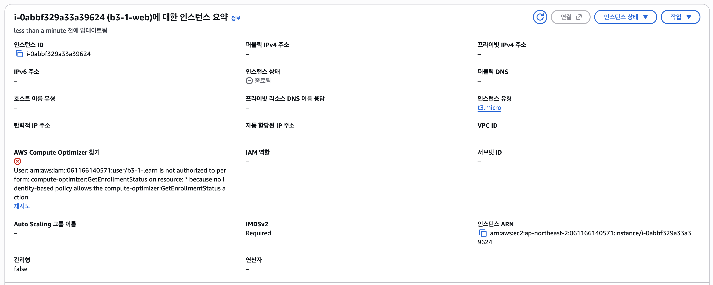
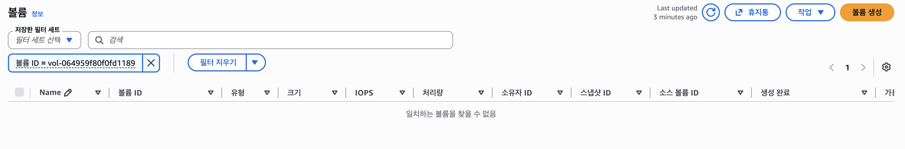
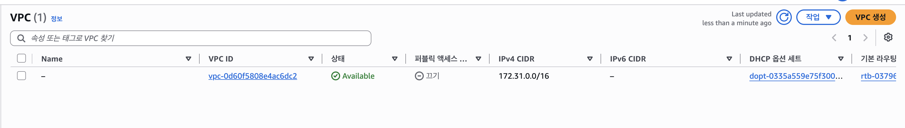
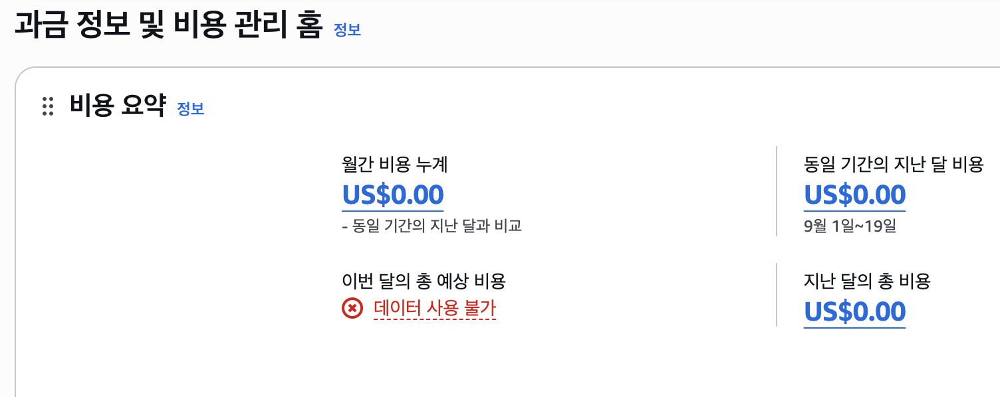

# 리소스 정리 체크리스트 (Cleanup Checklist)

- **계정 식별 정보**: AWS Account ID `061166140571` (`ap-northeast-2` 서울 리전 실습 환경)
- **리전**: `ap-northeast-2` (Asia Pacific - Seoul)
- **확인 일시**: `2026-10-19 14:54 ~ 15:13 KST`

---

## 1. 리소스별 정리 및 확인 현황

> **주의**: 외부 접속 증빙(`external-health.png`, `web-page.png`) 및 설정 파일 백업을 모두 완료한 뒤 아래 순서(의존성 역순)에 따라 리소스를 정리했습니다.

| 항목 | 실제 ID / 이름 | 결과 | 완료 시각 | 근거 및 비고 |
| :--- | :--- | :--- | :--- | :--- |
| **EC2 인스턴스** | `b3-1-web` (`i-0abbf329a33a39624`) | `Terminated` (종료 완료) | `2026-10-19 14:54 KST` | [캡처 (`terminate-instance.png`)](screenshots/terminate-instance.png) — 상태 `종료됨` 및 퍼블릭 IP(`3.38.185.189`) 반환 확인 |
| **EBS 볼륨** | 루트 볼륨 (`vol-064959f80f0fd1189`) | 삭제 완료 | `2026-10-19 14:57 KST` | [캡처 (`ebs-deleted.png`)](screenshots/ebs-deleted.png) — `DeleteOnTermination`에 의해 자동 삭제됨을 Volumes 목록에서 확인 |
| **Elastic IP** | 해당 없음 | **미생성 확인** | `2026-10-19 14:57 KST` | 목록 확인 — 실습에서 별도 할당하지 않음 (Elastic IPs 목록 비어 있음) |
| **Subnet** | `b3-1-public` (`subnet-0236c6a5155baa0de`) | 삭제 완료 | `2026-10-19 15:02 KST` | 목록 및 [VPC 정리 캡처](screenshots/vpc-deleted.png) — 라우팅 테이블 연결 해제 후 삭제 확인 |
| **사용자 Route Table** | `b3-1-public-rt` (`rtb-05f58c087b0f5b06a`) | 삭제 완료 | `2026-10-19 15:02 KST` | 목록 및 [VPC 정리 캡처](screenshots/vpc-deleted.png) — 서브넷 연결 해제 후 삭제 확인 |
| **사용자 Security Group** | `b3-1-web-sg` (`sg-0693f323650973b4f`) | 삭제 완료 | `2026-10-19 15:02 KST` | 목록 및 [VPC 정리 캡처](screenshots/vpc-deleted.png) — EC2 종료 후 Security Groups 목록에서 삭제 확인 |
| **Internet Gateway** | `b3-1-igw` (`igw-00cc79c30eacc990f`) | `Detach` 및 삭제 완료 | `2026-10-19 15:03 KST` | 목록 및 [VPC 정리 캡처](screenshots/vpc-deleted.png) — `b3-1-vpc`에서 분리(Detach) 후 삭제 확인 |
| **VPC** | `b3-1-vpc` (`vpc-052725d29ae2679ed`) | 삭제 완료 | `2026-10-19 15:03 KST` | [캡처 (`vpc-deleted.png`)](screenshots/vpc-deleted.png) — `b3-1-vpc` 삭제 후 기본 VPC(`172.31.0.0/16`)만 남은 상태 확인 |
| **키페어 (Key Pair)** | `b3-1-key` (`key-0ef54857207a6364b`) | 삭제 완료 | `2026-10-19 15:10 KST` | 목록 확인 — EC2 Key Pairs 콘솔 삭제 및 로컬 `~/.ssh/b3-1-key.pem` 파일 삭제 완료 |
| **NAT Gateway** | 해당 없음 | **해당 없음 — 미생성 확인** | `2026-10-19 15:03 KST` | Public Subnet 단일 구성으로 NAT Gateway 생성하지 않음 |
| **ELB / ALB** | 해당 없음 | **해당 없음 — 미생성 확인** | `2026-10-19 15:03 KST` | 단일 EC2 직접 연결 구성으로 로드 밸런서 생성하지 않음 |
| **RDS** | 해당 없음 | **해당 없음 — 미생성 확인** | `2026-10-19 15:03 KST` | 정적 웹 서비스 구성으로 RDS 데이터베이스 생성하지 않음 |
| **EBS 스냅샷** | 해당 없음 | **해당 없음 — 미생성 확인** | `2026-10-19 14:57 KST` | 커스텀 AMI 또는 스냅샷 생성하지 않음 (Snapshots 목록 확인) |

---

## 2. 리소스 정리 증빙 캡처

### 2-1. EC2 인스턴스 종료 확인 (`i-0abbf329a33a39624` → `종료됨`)


### 2-2. 루트 EBS 볼륨 삭제 확인 (`vol-064959f80f0fd1189` → `일치하는 볼륨을 찾을 수 없음`)


### 2-3. VPC 및 하위 네트워크 리소스 삭제 확인 (`b3-1-vpc` 삭제 완료)


---

## 3. 의존성 기반 안전한 삭제 순서 및 이유

AWS 리소스는 서로 참조(Dependency) 관계가 있으므로, 상위 리소스를 먼저 지우려 하면 `DependencyViolation` 오류가 발생합니다. 따라서 **가장 안쪽의 컴퓨팅 자원부터 바깥쪽 네트워크 경계 순서로** 정리했습니다.

```text
1. EC2 인스턴스 종료 (i-0abbf329a33a39624 → Terminated)
   └─ 실행 중인 인스턴스의 네트워크 인터페이스(ENI)가 Subnet과 SG를 점유하고 있으므로 가장 먼저 종료
2. EBS 루트 볼륨 삭제 확인 (vol-064959f80f0fd1189) 및 Elastic IP 미생성 확인
   └─ 인스턴스가 종료되어도 볼륨이나 EIP가 남으면 시간당 과금이 발생하므로 별도 목록에서 교차 확인
3. Route Table(rtb-05f58c087b0f5b06a)에서 Subnet 연결 해제 후 Subnet(subnet-0236c6a5155baa0de) 삭제
4. 사용자 Route Table(rtb-05f58c087b0f5b06a) 및 사용자 Security Group(sg-0693f323650973b4f) 삭제
5. Internet Gateway(igw-00cc79c30eacc990f)를 VPC에서 분리(Detach)한 뒤 삭제
6. 마지막으로 빈 껍데기가 된 VPC(vpc-052725d29ae2679ed) 삭제 및 키페어(key-0ef54857207a6364b) 정리
```

---

## 4. 과금 방지 및 Billing 확인

- **주요 과금 요인 점검**:
  1. **EC2 컴퓨팅 시간**: `t3.micro` 인스턴스 `Terminated` 전환으로 추가 컴퓨팅 시간 과금 차단 완료 (`Stop`이 아닌 `Terminate` 확인)
  2. **퍼블릭 IPv4 주소**: 별도 Elastic IP를 할당하지 않았고, 자동 할당 퍼블릭 IP(`3.38.185.189`)는 EC2 종료와 함께 즉시 반환됨
  3. **EBS 스토리지**: 8 GiB `gp3` 루트 볼륨(`vol-064959f80f0fd1189`)이 삭제되어 잔존 스토리지 과금 없음
  4. **고가 유료 네트워크 자원**: NAT Gateway, ALB, RDS 등은 처음부터 생성하지 않았음을 재확인
- **Billing 확인 결과 및 조회 시각**: `2026-10-19 15:13 KST` 기준 과금 정보 및 비용 관리 홈(Billing Dashboard)에서 **월간 비용 누계 `US$0.00`** 확인 (참고: 실습용 IAM 사용자 `b3-1-learn`은 최소 권한 정책에 따라 Billing 접근이 제한되어 있어, Billing 조회 권한이 있는 주체로 확인)
- **이후 재확인 계획**: 비용 정보 반영 지연을 고려하여 익일에도 과금 대시보드 재확인 예정
- **남은 항목이 있다면 이유와 조치**: 남은 실습 리소스 없음 (기본 VPC `vpc-0d60f5808e4ac6dc2` 및 계속 사용하는 실습용 IAM 사용자 `b3-1-learn`은 가이드 지침에 따라 유지)




