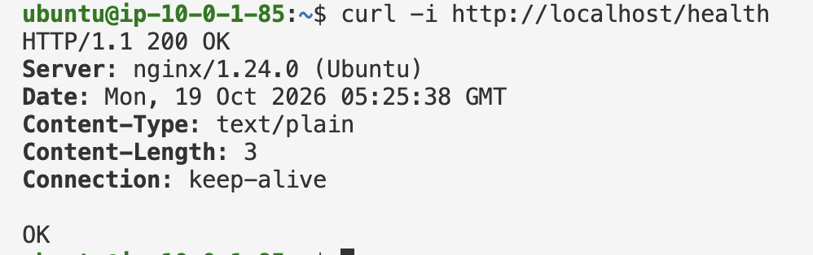
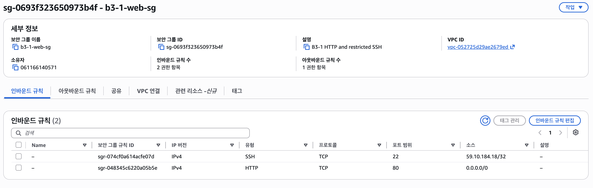
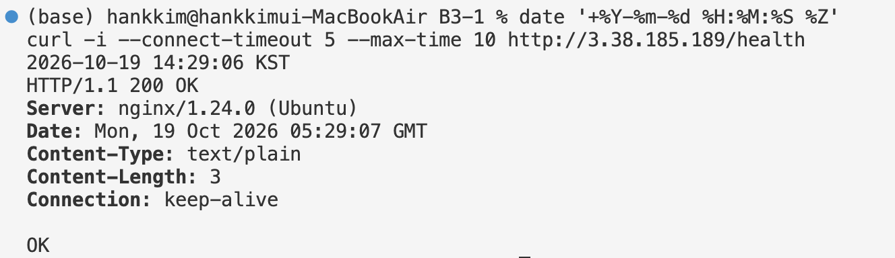

# 트러블슈팅 보고서 (Troubleshooting Report)

- **수행 일시**: 2026-10-19 14:25 ~ 14:35 KST
- **대상 리소스**:
  - **EC2**: `b3-1-web` (`i-0abbf329a33a39624` / 퍼블릭 IP: `3.38.185.189` / 프라이빗 IP: `10.0.1.85`)
  - **Security Group**: `b3-1-web-sg` (`sg-0693f323650973b4f`)
  - **VPC / Subnet**: `b3-1-vpc` (`vpc-052725d29ae2679ed`) / `b3-1-public` (`subnet-0236c6a5155baa0de`)
- **사례 구분**: 계획적 재현 (Security Group의 HTTP TCP 80 인바운드 규칙 제거에 따른 외부 접속 타임아웃 분석 및 복구)

---

## 1. 요약표 (증상 → 가설 → 검증 → 조치 → 결과 → 재발 방지)

| 항목 | 실제 수행 내용 |
| :--- | :--- |
| **증상 (문제 상황)** | • `b3-1-web-sg`에서 HTTP(TCP 80) 인바운드 규칙을 제거한 뒤, 외부(개인 Mac 터미널)에서 `curl -i --connect-timeout 5 --max-time 10 http://3.38.185.189/health` 요청 실행<br>• 5초 동안 응답이 없다가 `curl: (28) Connection timed out after 5000 milliseconds` 오류 발생 (2026-10-19 14:27 KST) |
| **가설 (원인 추정)** | • **가설 1 (서버 내부 프로세스 문제)**: EC2 내부의 Nginx 서비스가 중지되었거나 TCP 80 포트에서 리스닝하지 않고 있을 가능성<br>• **가설 2 (네트워크 경계 방화벽 차단)**: Nginx는 정상 실행 중이나, EC2에 연결된 Security Group(`sg-0693f323650973b4f`)에서 TCP 80 인바운드 트래픽이 허용되지 않아 패킷이 서버에 도달하기 전 차단(Drop)되었을 가능성 |
| **검증 (근거 확인)** | 1. **내부 상태 검증 (가설 1 기각)**:<br>   • SSH(TCP 22) 연결은 유지된 상태에서 EC2 내부 점검 수행<br>   • `systemctl is-active nginx` → `active` 확인<br>   • `sudo ss -lntp` → `0.0.0.0:80`에서 Nginx 프로세스 리스닝 확인<br>   • `curl -i http://localhost/health` → 내부에서는 즉시 `HTTP/1.1 200 OK` 및 `OK` 반환<br>2. **네트워크/방화벽 검증 (가설 2 채택)**:<br>   • `sudo tail -n 30 /var/log/nginx/access.log` 확인 시 외부에서 실패한 요청이 아예 기록되지 않음 (요청이 Nginx까지 도달하지 못함)<br>   • AWS 콘솔에서 `b3-1-web-sg`의 인바운드 규칙 확인 결과, SSH(22) 규칙만 존재하고 HTTP(80) 규칙이 없음을 확인 |
| **조치 (해결 방법)** | • AWS 콘솔 **EC2 → Security Groups → `b3-1-web-sg` (`sg-0693f323650973b4f`) → Edit inbound rules** 이동<br>• HTTP 허용 규칙 복구: `Type: HTTP`, `Protocol: TCP`, `Port: 80`, `Source: 0.0.0.0/0` 추가 후 저장 (기존 SSH 22 내 공인 IP `59.10.184.18/32` 규칙은 그대로 유지) |
| **결과 (조치 후 검증)** | • 외부 Mac 터미널에서 새 프로세스로 `curl -i --connect-timeout 5 --max-time 10 http://3.38.185.189/health` 재호출<br>• 즉시 `HTTP/1.1 200 OK` 헤더와 본문 `OK`가 정상 반환됨 (2026-10-19 14:29:06 KST)<br>• 웹 브라우저에서도 `http://3.38.185.189` 접속 시 `Hello Cloud` 페이지 정상 출력 확인 |
| **재발 방지** | 1. **배포 직후 인바운드 규칙 교차 점검**: 인스턴스에 실제로 연결된 SG ID(`sg-0693f323650973b4f`)를 확인하고, 외부 공개용 포트(TCP 80: `0.0.0.0/0`)와 관리용 포트(TCP 22: `내 공인 IP/32`)가 정확히 설정되었는지 콘솔에서 캡처·검증한다.<br>2. **새 연결 기반 검증 수행**: SG는 Stateful 방화벽이므로 기존 브라우저의 Keep-Alive 세션이 남아 있으면 규칙 변경 직후에도 접속되는 것처럼 보일 수 있다. 반드시 터미널에서 새 `curl` 프로세스로 검증한다.<br>3. **단계적 격리 진단 준수**: 외부 접속 실패 시 무작정 `All traffic (0.0.0.0/0)`을 열지 않고, `EC2 내부 localhost 응답 확인 → 포트 리스닝(ss -lntp) 확인 → SG 인바운드/라우팅 확인` 순서로 원인을 좁힌다. |

---

## 2. 상세 재현 및 분석 과정

### 2-1. 장애 재현 및 증상 관측 (외부 요청 실패)

정상 동작을 확인한 후, `b3-1-web-sg` (`sg-0693f323650973b4f`) 인바운드 규칙에서 HTTP(TCP 80) 규칙을 제거하고 개인 Mac 터미널에서 새로운 연결 요청을 전송했다.

```bash
# 실행 위치: 개인 Mac 터미널 (외부 네트워크)
$ date '+%Y-%m-%d %H:%M:%S %Z'
2026-10-19 14:27:12 KST

$ curl -i --connect-timeout 5 --max-time 10 http://3.38.185.189/health
curl: (28) Connection timed out after 5002 milliseconds
```

- `Connection refused`(포트 닫힘 즉시 거부)가 아니라 **`Connection timed out`(응답 없음)**이 발생했다. 이는 패킷이 목적지에서 명시적으로 거부(RST)된 것이 아니라 중간 방화벽(Security Group) 또는 라우팅 경계에서 조용히 폐기(Drop)되었음을 시사한다.

### 2-2. 원인 격리: EC2 내부 상태 및 로컬 응답 확인

문제가 웹 서버(Nginx) 자체의 장애인지, 네트워크/방화벽 구간의 차단인지 구분하기 위해 SSH로 접속한 EC2 터미널에서 내부 상태를 점검했다.

```bash
# 실행 위치: EC2 내부 (ubuntu@ip-10-0-1-85)
$ systemctl is-active nginx
active

$ sudo ss -lntp | grep ':80'
LISTEN 0      511          0.0.0.0:80        0.0.0.0:*    users:(("nginx",pid=...,fd=6))

$ curl -i http://localhost/health
HTTP/1.1 200 OK
Server: nginx/1.24.0 (Ubuntu)
Date: Mon, 19 Oct 2026 05:25:38 GMT
Content-Type: text/plain
Content-Length: 3
Connection: keep-alive

OK
```

- **판단 근거**:
  1. `systemctl is-active nginx`가 `active`이며, `0.0.0.0:80`에서 정상적으로 모든 IPv4 인터페이스의 요청을 대기 중이다.
  2. EC2 내부에서 `http://localhost/health` 호출 시 `HTTP/1.1 200 OK`와 `OK`를 정상 반환한다.
  3. `/var/log/nginx/access.log`를 확인했을 때 외부 Mac에서 보낸 타임아웃 요청은 로그에 전혀 남지 않았다.
  4. 즉, **Nginx 애플리케이션과 OS 내부 설정은 정상**이며, 외부 요청이 EC2 인스턴스 내부까지 도달하지 못하고 AWS Security Group에서 차단되었음이 입증되었다.

### 2-3. 조치 및 복구 검증

1. AWS 콘솔에서 `b3-1-web-sg` (`sg-0693f323650973b4f`)의 인바운드 규칙에 `HTTP / TCP / 80 / 0.0.0.0/0` 규칙(`sgr-048345c6220a05b5e`)을 다시 추가하고 저장했다.
2. 개인 Mac 터미널에서 동일한 명령으로 재검증을 수행하여 즉시 `200 OK` 응답이 돌아오는 것을 확인했다.

```bash
# 실행 위치: 개인 Mac 터미널 (복구 후 재검증)
$ date '+%Y-%m-%d %H:%M:%S %Z'
$ curl -i --connect-timeout 5 --max-time 10 http://3.38.185.189/health
2026-10-19 14:29:06 KST
HTTP/1.1 200 OK
Server: nginx/1.24.0 (Ubuntu)
Date: Mon, 19 Oct 2026 05:29:07 GMT
Content-Type: text/plain
Content-Length: 3
Connection: keep-alive

OK
```

---

## 3. 증빙 스크린샷

### 3-1. EC2 내부 `localhost/health` 정상 응답 확인 (`internal-health.png`)


### 3-2. Security Group 인바운드 규칙 복구 상태 (`security-group.png`)
- **HTTP (TCP 80)**: `0.0.0.0/0` 허용 (`sgr-048345c6220a05b5e`)
- **SSH (TCP 22)**: `59.10.184.18/32` 내 공인 IP만 허용 (`sgr-074cf0a614acfe07d`)



### 3-3. 조치 후 외부 Mac에서 `/health` 정상 응답 확인 (`external-health.png`)


